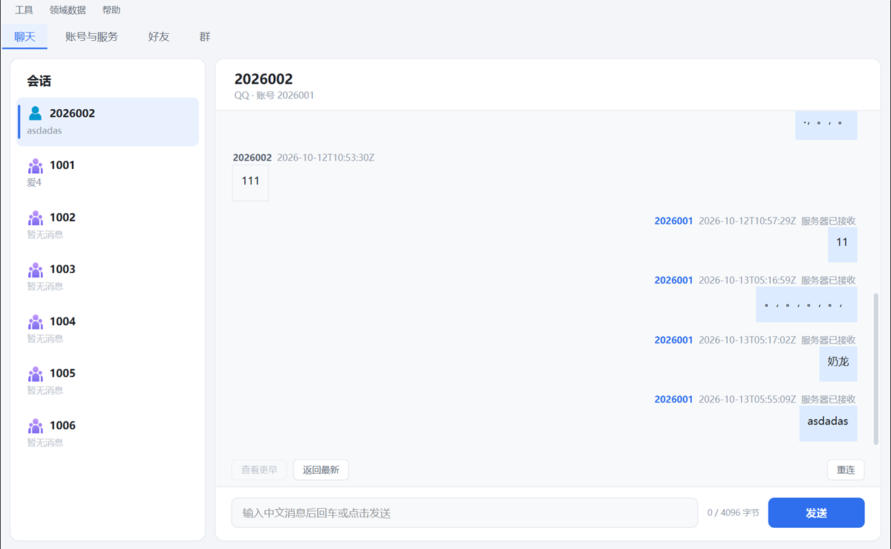
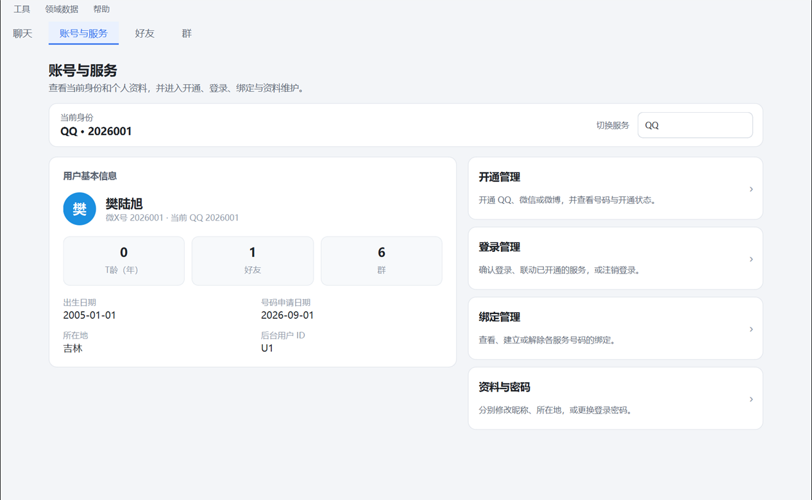
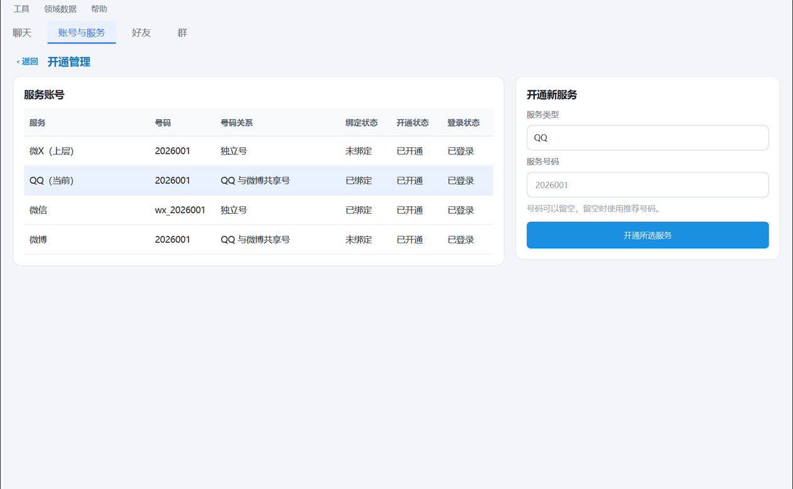
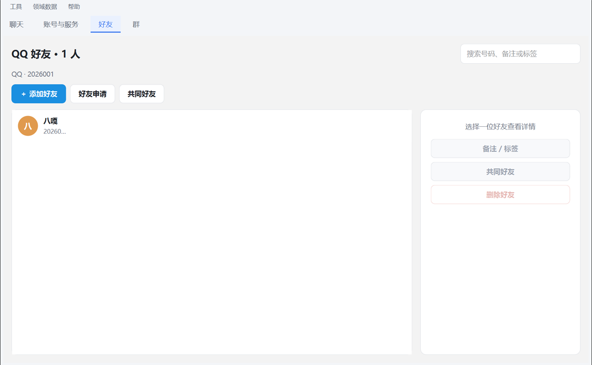

# 樊陆旭模拟即时通讯系统

面向对象课程设计 · C++17 · 552502 班

用**微X号**登录，再开通 QQ、微信或微博。聊天、好友和群都跟随当前服务。控制台菜单和 Qt 图形客户端共用同一套账户、好友、群与持久化。

演示账号 `2026001`，密码 `123`。另一个可联调的账号是 `2026002`。

<p align="center">
  
</p>

## 界面

登录后有四个页签：聊天、账号与服务、好友、群。下面是实机界面。

<table>
  <tr>
    <td width="50%"><b>聊天</b><br>好友与群分列在左侧，消息经服务器转发。</td>
    <td width="50%"><b>账号与服务</b><br>查看资料，进入开通、登录、绑定和改密。</td>
  </tr>
  <tr>
    <td></td>
    <td></td>
  </tr>
  <tr>
    <td><b>开通管理</b><br>微X 是上层账号。QQ、微信、微博在这里单独开通。</td>
    <td><b>好友</b><br>好友按当前服务分开。可以添加、处理申请、查共同好友。</td>
  </tr>
  <tr>
    <td></td>
    <td></td>
  </tr>
</table>

群页列出当前服务的群、成员，以及邀请、审批和设置入口。QQ 和微信有群，微博只有单聊。

## 怎么用

| | |
| --- | --- |
| 登录 | 只认微X号和注册时设置的密码。失败会留在登录窗。 |
| 开通 | 注册只创建微X，不附带任何服务。登录后到「开通管理」开通 QQ、微信或微博。 |
| 号码 | 演示数据里，QQ 和微博沿用微X号，微信是 `wx_` 加微X号。QQ 与微博虽同号，消息互不串。 |
| 聊天 | 连接属于当前服务。QQ 的好友不会出现在微信或微博里。 |

## 跑起来

Windows、CMake 3.20 以上、MinGW。图形界面需要 Qt 6（本机验证 6.11.1）。JSON 头文件随仓库提供，配置和构建不用联网。

```powershell
# 图形界面
cmake -S . -B build -G "MinGW Makefiles" -DFANLX_BUILD_GUI=ON -DCMAKE_PREFIX_PATH="E:/Qt/6.11.1/mingw_64"
cmake --build build -- -j4
powershell -File scripts/deploy-gui.ps1 -TargetDir build -QtBin "E:/Qt/6.11.1/mingw_64/bin" -MinGwBin "D:/mingw64/bin"
scripts\run-gui.bat
```

`scripts\run-gui.bat` 从项目根启动，带上数据目录，并在需要时拉起本机服务端。换端口或账号：`scripts\run-gui.bat 9600 2026002`。

只要控制台时，去掉上面的 `-DFANLX_BUILD_GUI` 和 Qt 路径，构建后运行：

```powershell
.\build\fanlx_app.exe --demo
ctest --test-dir build --output-on-failure
```

参数、三端联调、数据目录和排错见 [HELP.md](HELP.md)。

## 代码在哪

```
include/  src/          账户、好友、群、持久化、网络
src/gui/                Qt 客户端（登录、四个页签）
src/ui/                 数字菜单
tests/                  自动化测试
scripts/run-gui.bat     启动图形客户端
```

## 更多文档

| 文档 | 内容 |
| --- | --- |
| [HELP.md](HELP.md) | 构建、命令、联调、测试、排错 |
| [docs/project-structure.md](docs/project-structure.md) | 目录、依赖和测试清单 |
| [docs/architecture.md](docs/architecture.md) | 分层和职责 |
| [docs/storage-layout.md](docs/storage-layout.md) | 每个数据文件是什么、哪一份算数 |
| [docs/network-validation.md](docs/network-validation.md) | 服务器转发的协议和时序 |
| [docs/data-format.md](docs/data-format.md) | 快照格式（schemaVersion 2） |
