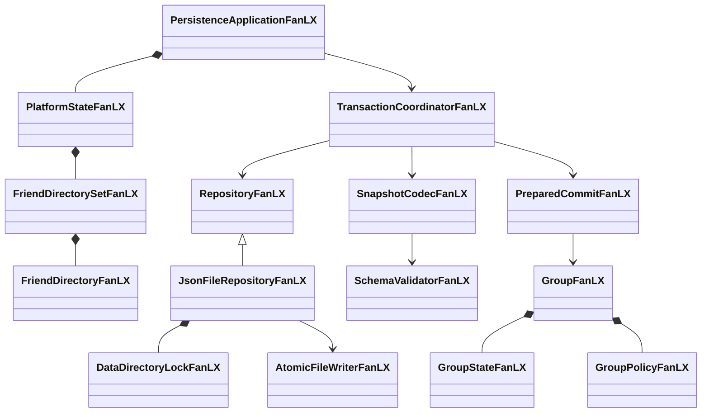
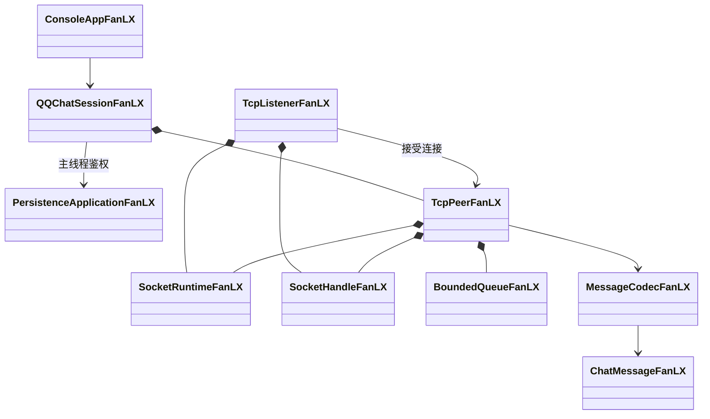

> 2026-09-23 IM增量更新：原S08点对点菜单已改为登录长连接+中心转发；新增 ImClientFanLX/ImServerFanLX、持久化 outbox/inbox/ACK 与好友在线状态。下面旧S08章节保留历史背景，当前网络设计以 [network-validation.md](network-validation.md) 为准。2026-10-14 起，在线好友单聊可以再开一条客户端之间的 TCP，协商和回退见 [hybrid-tcp.md](hybrid-tcp.md)。
>
> 2026-09-30 凭据改造：登录改为「用户名（QQ 号）+ 用户自选密码」，账号库就是领域快照 `users[].password`（课程范围内明文保存）；`--im-tokens` / `--token` / `--tokens` 与令牌文件、`scripts/im-tokens.ps1` 全部移除。下文 S02/S08 章节保留历史背景，当前凭据设计见「账户域」的「凭据与登录」小节。
>
> 2026-10 微X 上层与按服务分区改造：新增 `ServiceTypeFanLX::WeiX` 作为 QQ / 微信 / 微博 的**上层登录身份**，注册不再捆绑任何服务账号；好友改为按服务分区存放（`FriendDirectorySetFanLX`）；资料支持单项修改；快照格式升到 schemaVersion = 2；IM 会话按 `(服务, 号码)` 认证与投递。下文 S02/S03/S08 章节保留历史背景，当前设计见「账户域」的「微X 上层与身份分层」「好友域」与文末「2026-10 微X 上层与按服务分区」。
>
> 2026-10 第二轮（微博成为聊天通道）：**微博除群以外全部可用**（资料 / 开通 / 登录联动 / 好友 / 单聊 / 历史 / 在线状态），能力判定收敛到 `chatCapableFanLX` 与 `groupCapableFanLX` 两个函数；`activateService` 取消"QQ 号与微信号不能相同"的限制，号码改为**按服务各自唯一**（QQ 与微博仍必须共号）；服务端内部改用**通道标识** `<服务名>|<号码>` 存放与投递，出站帧一律剥回纯号码（客户端协议与客户端库格式不变）；客户端聊天目录再按服务分一层（`chatDirectoryFanLX`）；演示种子改为两条好友关系（QQ + 微博）。见文末「2026-10 第二轮：微博成为聊天通道与服务端通道标识」。

# 架构说明 — 樊陆旭模拟即时通讯系统

## 分层概览

```
┌─────────────────────────────────────────────────────────┐
│  Presentation / Entry（入口层）                          │
│  main.cpp · ConsoleAppFanLX（已实现）                   │
├─────────────────────────────────────────────────────────┤
│  Application / Service（业务服务层）                     │
│  AccountManagerFanLX · FriendServiceFanLX               │
│  GroupServiceFanLX（S04/S05 已实现）                           │
├─────────────────────────────────────────────────────────┤
│  Domain（领域层）                                        │
│  UserProfileFanLX · ServiceAccountFanLX                 │
│  FriendDirectoryFanLX · FriendDirectorySetFanLX         │
│  IdentityResolverFanLX                                  │
│  GroupFanLX · GroupStateFanLX · DiscussionGroupFanLX    │
│  GroupPolicyFanLX（抽象）及其子类                        │
├─────────────────────────────────────────────────────────┤
│  Infrastructure（基础设施层）                            │
│  LruListFanLX · LruCacheFanLX · ArcCacheFanLX          │
│  LfuFrequencyFanLX · MemoryPoolFanLX                    │
│  JsonFileRepositoryFanLX（S06 已实现）                       │
└─────────────────────────────────────────────────────────┘
```

依赖方向：上层依赖下层，下层不依赖上层。

---

## 已实现类关系

### 账户域（S02）

```
ServiceTypeFanLX（enum class）
    QQ / Wechat / Weibo / WeiX   // WeiX 是 QQ/微信/微博 的**上层登录身份**（2026-10 新增）
    存储名 serviceNameFanLX：QQ / Wechat / Weibo / WeiX（禁止改动，是数据格式的一部分）
    界面中文名 serviceDisplayNameFanLX：QQ / 微信 / 微博 / 微X（界面上不出现 "Wechat" 这种存储名）
    解析 serviceFromNameFanLX：同时接受存储名与中文名，认不出返回 false（不抛异常）
    判定 isSubordinateServiceFanLX（只有 QQ/微信/微博 需要"开通"）
         chatCapableFanLX（三种下级服务**都能单聊**：QQ / 微信 / 微博；微X 是上层身份，不承载聊天）
         groupCapableFanLX（只有 QQ 与微信有群：微博除群以外的功能都可用）

UserProfileFanLX（struct）
    userId · nickname · birthDate · applyDate · location · password

ServiceAccountFanLX（struct）
    userId · service · accountId · sharedId

AccountManagerFanLX（后端层：以内部 userId 为键）
    ├── usersFanLX         : unordered_map<string, UserProfileFanLX>
    ├── accountsFanLX      : unordered_map<string, ServiceAccountFanLX>
    ├── accountIdIndexFanLX: unordered_map<string, string>  // "服务名|账号ID" -> 账号键（唯一性 + O(1) 定位）
    ├── subscriptionsFanLX : unordered_set<string>   // 存储键 "userId|服务名"
    ├── bindingsFanLX      : unordered_map<string, string>  // 账号键 -> 与之绑定的另一账号键
    └── loggedInFanLX      : unordered_set<string>   // 登录态，以"平台账号"为主体
    后端配给：addUser · addAccount · subscribe
    微X 上层（2026-10）：registerWeiXAccount(profile, weixAccountId)
                        // 只建微X账号并立刻置为已开通，**不建任何下级服务账号**
                    activateService(user, service, accountId)
                        // 建下级服务账号 + 立即开通（校验见下文「微X 上层与身份分层」）
    资料维护（2026-10）：updateNickname / updateLocation   // 空串 = 该项不改（支持单项修改）
                    updateProfile(nickname, location)   // 保留为"两项一起改"的便捷入口
    共享号码：syncSharedFlagsFanLX    // QQ 与微博必须同号（两边都标 sharedId）
    前端入口：login（用户名 + 密码校验通过后签发会话；界面上的登录身份只有微X号）
    凭据入口：verifyPassword · changePassword · resumeSession · confirmLoginInSession
    后端查询：isSubscribed · isLoggedIn · profile · account · findAccount · accounts
    平台账号视角：hasAccount · isAccountSubscribed · isAccountLoggedIn · accountByAccountId
                 logout · logoutAll · bindAccounts · unbindAccounts · isBound · bindingsOf

AccountSessionFanLX（前端身份凭证，由 login 签发）
    ├── service() · accountId()                    // 对外的全部身份信息
    ├── isLoggedIn()                               // 会话是否仍有效
    ├── subscribeTo(service)                       // 自主开通（平台须已有本人的服务账号）
    ├── activateService(service, accountId)        // 开通下级服务：建号 + 开通一步完成
    │                                              // **只有微X会话能调用**，否则抛异常（权限落点）
    ├── isWeiXSession()                            // 当前身份是否为微X（上层账号）
    ├── bindTo / unbindFrom / boundAccounts        // 绑定：建立 / 解除 / 查询
    ├── logout() / logoutAll()                     // 当前服务注销 / 平台注销
    └── 私有 userIdFanLX（无访问器，前端取不到）

服务错误分类（均继承 std::runtime_error）
    ServiceNotSubscribedFanLX（未开通）· ServiceNotConfirmedFanLX（未确认）· SessionExpiredFanLX（已过期）
    CredentialRejectedFanLX（用户名或密码错误；账号不存在与密码错误共用同一条信息）
    开通服务需要以微X身份登录（std::runtime_error：非微X会话调用 activateService）
```

**身份分层与接口分层（2026-09-14 修订 rev2，对齐工程计划 §4.1、§4.2）**

三层身份：**人**以不可变内部 `userId` 标识；**服务账号**以 `(ServiceType, accountId)` 标识；
**开通记录**以 `(userId, ServiceType)` 标识。由此推出接口分层：

- **前端 API = 登录会话**：凡"由某个已登录用户发起"的操作一律经由 `AccountSessionFanLX`，
  签名中不出现 `userId`；对方一律以平台账号 `(service, accountId)` 指定。
  现实中加好友用的是对方的 QQ 号 / 微信号，不是后台用户 ID。
- **后端 API = 配给/统计/持久化**：注册用户、建号、开通、按用户查询保留在 `AccountManagerFanLX`
  上并显式以 `userId` 为参数，前端不调用。
- `login(service, accountId, password, confirmOthers)` 是唯一登录入口（旧有的 userId 版重载已删除）：
  平台侧校验凭据（用户名 + 用户自选密码）后系统拿到的是账号 ID，再由账号反查归属用户。
- `confirmOthers == true` 的联动**只依据两条规则**：
  1. **同号**：双方 `sharedId == true` 且 `accountId` 相同（QQ 与微博复用同一账号 ID）；
  2. **显式绑定**：`bindingsFanLX` 中存在双向绑定记录。

  仅"同一个人"而既不同号也未绑定时**不联动**，避免登录 QQ 顺带登录无关平台。
  联动范围仅限该用户**已开通**的平台。
- **绑定**以平台账号为参数（`bindAccounts` / 会话的 `bindTo`），归属校验在内部完成：
  双方必须属于同一 `userId`，因此"输入任意 QQ 号就能绑定他人账号"会被拒绝；
  提供建立 / 查询（`isBound`、`bindingsOf`）/ 解除（`unbindAccounts`）三组接口。
- **账号 ID 唯一性**：`addAccount` 保证同一平台的 `accountId` 不被两人共用——
  既然 accountId 是登录身份，它就必须能唯一定位账号；索引 `accountIdIndexFanLX` 同时承担该校验。
- 不变量：`addAccount` 保证「一个用户在一个平台只持有一个账号」，因此存储键 `"userId|服务名"`
  是该平台账号的无损别名；好友域 `IdentityResolverFanLX` 的 3 段键 `"userId|服务名|accountId"`
  在此不变量下第三段不产生新维度，保留以维持键格式对上层稳定。

**凭据与登录（2026-09-30 修订）**

用户名就是平台账号 ID（QQ 号），密码由用户在注册时自选。不再有令牌文件、预共享密钥或凭据分发脚本：
账号库就是领域账号表，密码以 `password` 字段随快照持久化（字段约束见 data-format.md）。

- **为什么明文**：课程范围内不引入哈希与盐值，`users[].password` 暂按**明文**保存。
  这条取舍只对演示数据成立；真实部署必须改成加盐哈希并在传输层加 TLS（明文口令不能当公网认证用）。
- **一个用户一个密码**：密码存在 `UserProfileFanLX`（人）而不是 `ServiceAccountFanLX`（平台账号）上，
  所以同一个人的 QQ + 微博（同号）+ 微信（独立号、绑到 QQ 号）用**同一个**密码。这也是它比"每平台一个令牌"
  更省事的地方：登录一个平台加一次简单确认，就能把该用户**已开通**的同号/绑定平台一并登录，
  而不是让用户为每个平台各记一份凭据。
- **失败信息统一**：`login` 在「账号不存在」与「密码错误」两种情况下都抛
  `CredentialRejectedFanLX("用户名或密码错误")`。故意不区分——若两种提示不同，任何人靠试错就能枚举出
  系统里存在哪些 QQ 号。IM 服务端沿用同一句话并作为 ERROR 帧回给客户端；
  只有「密码正确但该账号没开通 QQ」才另回 `该账号未开通 QQ 服务`（这是账号已存在的信息，用户本来也知道）。
- **校验与会话分离**：`verifyPassword(service, accountId, password)` 只回答「密码对不对」；
  `resumeSession(...)` 由**已登录状态**重建句柄，不重新校验密码；`confirmLoginInSession(...)` 逐项确认登录，
  授权来自「同一用户的一个已认证会话」，并且仍然要求同号或显式绑定。密码校验只发生在 `login` 一处，
  因此所有"不校验密码"的入口都建立在已经校验过的会话之上，绕不过这一次校验。
- **修改密码**：`changePassword(service, accountId, oldPassword, newPassword)` 先校验旧密码再改，
  **不要求当前处于登录态**——改密的凭据是旧密码本身，而会话可能早已过期。应用层入口
  `PersistenceApplicationFanLX::changePassword` 走事务提交，`users` 局部版本提升并按版本失效缓存；
  控制台账号菜单的 `10 修改密码` 要求新密码二次输入，改完后本次 IM 连接同步新凭据以便重连。
- **旧数据的处理**：改造前写出的快照没有 `password` 字段，读取时按空串处理，随即被校验器拒绝：
  `用户缺少登录密码（旧数据请重新 --init-demo 初始化）`。迁移方式是删掉该数据目录后重新 `--init-demo`。
  不就地补字段的理由：随手补一个默认密码等于凭空造出一条人人可猜的凭据，而空密码在规则里本就不合法，
  宁可让旧库显式重建，也不要让一个"看起来能登录"的弱凭据悄悄留在盘上。

**微X 上层与身份分层（2026-10 修订）**

原先 QQ / 微信 / 微博 三种服务各自是登录入口，注册时还得一次性把服务账号都捆上。现在改成两层：

- **微X 是唯一登录身份。** `registerWeiXAccount(profile, weixAccountId)` 只创建微X账号并**立刻把它置为已开通**
  （否则注册完无法登录），**不创建任何下级服务账号**；`ServiceAccountFanLX` 结构不变，微X 只是多了一个
  `ServiceType` 取值，因此账号唯一性、`accountIdIndexFanLX` 与既有的绑定机制原样复用。
- **QQ / 微信 / 微博 是开通出来的下级服务。** `activateService(user, service, accountId)` 一步完成
  "建号 + 立即开通"，并校验三件事：必须是下级服务（微X 不能被"开通"）、本人必须有微X账号、
  号码在**该服务内**未被占用（索引 `accountIdIndexFanLX` 的键是 `服务名|号码`）。
  号码只要求"各自服务内唯一"：QQ 与微博按课程约定**必须共用同一个号码**
  （`syncSharedFlagsFanLX` 保证），微信也可以直接用与 QQ 相同的号码——服务端按"服务 + 号码"
  分通道存放与投递，客户端聊天目录也带服务名，两条通道不会互相串消息（见文末「服务端通道标识」）。
- **权限落点在会话上。** `AccountSessionFanLX::activateService` 要求 `serviceFanLX == WeiX`，
  否则抛「开通服务需要以微X身份登录（微X 是 QQ/微信/微博 的上层账号）」。
  这就是"只有登录微X后才能在内部开通三种服务"的唯一落点：控制台与 Qt 界面都不必各自再判一次身份，
  `isWeiXSession()` 只用于决定要不要展示"开通管理"。`AccountManagerFanLX::activateService` 里
  仍再校验一次"本人有微X账号"的账号事实，两层各管一件事（一个是授权，一个是数据完整性）。
- **登微X 即授权。** `loginCoreFanLX` 中若登录的是微X账号且 `confirmOthers == true`，本人**全部已开通**
  的下级服务一并登录——授权来源就是这一次微X登录本身，不再要求下级之间同号或互相绑定；
  `confirmLoginInSession` 同样接受"微X → 下级服务"。下级服务之间仍保留"同号 / 显式绑定"这条老规则，
  避免登录 QQ 顺带登录无关平台。
- **共享号码标记统一维护。** `syncSharedFlagsFanLX` 在每次开通后重算：QQ 与微博两边都在时必须同号
  （否则抛异常，宁可拒绝也不写出一份自相矛盾的账号库），此时两边都标 `sharedId`；
  只有一边时，号码等于微X号才视为共享——微X号是本人的统一号码，QQ/微博沿用它就是"同号"。

**单项资料修改（2026-10 修订）**

`updateNickname` / `updateLocation` 以**空串表示"这一项不改"**，因此界面可以只提交昵称或只提交所在地；
`updateProfile(nickname, location)` 保留为"两项一起改"的便捷入口，实现就是依次调用上面两个方法。
界面（`AccountPageFanLX`）相应把资料维护拆成「保存昵称」「保存所在地」两个独立按钮，
两项都留空时按「昵称与所在地都为空：没有要修改的内容」拒绝，而不是静默成功。

### 数据目录与身份边界（2026-09-29 新增）

客户端存储目录**不是用户输入**，而是由「服务器身份 + 登录账号（+ 服务）」派生。规则只写在一处：
`include/network/ClientDataPathFanLX.h`。

```
<数据根>/im-client/<host>_<port>/<账号目录名>/
    ├─ domain/                客户端领域库（用户资料 / 开通 / 好友 / 群）
    └─ <服务名>/              聊天存储按**服务**再分一层（QQ / Wechat / Weibo）
         ├─ client-identity.json   身份与归属记录（schema / 账号 / 服务器实例 / host / port / device）
         ├─ chat.db                --im-sqlite 时的聊天库
         └─ state.json             旧 JSON 后端
```

四个设计决定及理由：

1. **顺序是「身份 → 派生路径」，不是「先选路径 → 事后校验」。**
   旧实现在登录窗口提供「选择数据目录」，登录后再用 `client-identity.json` 审计该目录是否属于本账号。
   这等于把本该由程序保证的不变式降级成一次可失败的检查，而且用户会因选错目录而「把历史看丢」。
   现在 `dataRoot` 是唯一入参，账号子目录在 `ChatControllerFanLX::start` 与控制台登录处派生，
   界面只做只读预览（登录窗实时显示「登录后数据目录：…」）。

2. **目录名必须带服务器身份。** `accountId` 只在单个服务端内唯一（见上文 `addAccount` 的唯一性约束）；
   只按账号派生会让不同服务器上的同名账号共用目录而互相污染。故以 `<host>_<port>` 作中间层，
   并保留 `client-identity.json` 校验（`server_instance_id` / `host` / `port` / `account`）作为第二道防线。

3. **数据根是唯一允许被覆盖的部分。** 测试、`--demo`、`tools/gui_screenshot` 都使用临时根，
   避免污染仓库数据（见 [network-validation.md](network-validation.md)）。账号子目录始终由程序决定，
   任何入口都不接受「指到某个账号目录」。

4. **聊天目录还要再按服务分一层。** `chatDirectoryFanLX(root, host, port, service, accountId)`
   = `<账号目录>/<服务名>`，`service` 取存储名（QQ / Wechat / Weibo），与网络协议里的 `service`
   字段同一套取值。QQ 与微博按课程约定共用同一个号码，两条聊天通道的账号字符串完全相同；
   不再分这一层，同一个人的 QQ 会话与微博会话就会落进同一个 `chat.db`、争用同一把目录锁。
   现在三条通道各自一份聊天库、各一把目录锁，互不覆盖；`ChatControllerFanLX::start` /
   `dataDirectory()` 与控制台 `openImClientFanLX` 都改用这个派生函数，界面预览与实际落盘同源。
   领域库仍在 `<账号目录>/domain`（用 `domainDirectoryFanLX` 派生），与聊天库互不干扰，可以同时打开。

> 迁移提示：旧布局把 `chat.db` / `state.json` 直接放在账号目录下，新版放在账号目录的**服务子目录**里。
> 旧的客户端存储目录可以直接删除（闲聊历史会重新累积），`domain/` 里的领域数据不受影响；
> 已经带 `domain/` 的账号目录也可以只删服务子目录后重新登录。

目录名转义按**字节**进行（只保留 ASCII 字母数字与 `-_.`，其余写作 `%XX`），保证一对一映射、
不受 locale 影响；`.` 与 `..` 会被强制转义，避免跳出数据根。

角色与根的对应关系（运行期数据目录均被 `.gitignore` 忽略）：

| 角色 | 数据根 | 根内布局 |
| --- | --- | --- |
| 服务端（`--im-server`） | `data-im-server` | `state.json` + `im-server/`（消息库） |
| 控制台客户端 | `data-im-a`、`data-im-b`（每个控制台实例一个根，因为控制台还承载领域快照） | `state.json` + `im-client/<host>_<port>/<账号>/{domain,<服务名>}/` |
| GUI 客户端（`fanlx_gui`） | `data-im-gui`（**单根多账号**，隔离由派生负责） | `im-client/<host>_<port>/<账号>/{domain,<服务名>}/` |

服务端是唯一不适用「按账号派生」的一侧：它没有登录账号，只有一份权威存储，路径属于部署配置，
由管理员用 `--data-dir` 决定。因此「按登录账号分配路径」这条规则只对客户端成立。

### 好友域（S03）

```
FriendshipFanLX（struct）
    ownerAccountKey · peerAccountKey · remark · tag

FriendDirectoryFanLX（单个服务的好友目录：无向图 + 备注/标签）
    ├── adjacencyFanLX : unordered_map<string, unordered_set<string>>  // 无向图
    └── detailsFanLX   : unordered_map<string, FriendshipFanLX>        // 键 "owner\npeer"
    方法：contains · add · remove · update · detail · peers · pairCount · clear

FriendDirectorySetFanLX（2026-10 新增：**按服务分区**的好友目录集合）
    └── directoriesFanLX : std::map<ServiceTypeFanLX, FriendDirectoryFanLX>
    方法：directory(service)   // 读接口对不存在的分区返回空目录，调用方不必区分"没有"与"空"
         partitions()        // 已建立分区的服务（按服务枚举升序，输出稳定）
         pairCount(service)  // 委托给该服务目录的 pairCount（邻接表双向登记，因此按关系对计数）
         clear()             // 候选事务回滚 / 重建状态

IdentityResolverFanLX
    └── accountsFanLX : const AccountManagerFanLX&
    方法：accountKey（service+accountId → "userId|服务名|accountId"）   // 前端口径
         accountKeyOfUser（userId+service → 账号键，缺失返回空串）      // 内部口径
         userForAccount（账号键 → userId）                            // 仅内部聚合使用

FriendServiceFanLX（门面）
    ├── directoriesFanLX : FriendDirectorySetFanLX&   // 按服务分区（原来是一份 FriendDirectoryFanLX）
    ├── accountsFanLX    : const AccountManagerFanLX&
    └── resolverFanLX    : IdentityResolverFanLX（组合成员）
    前置校验（2026-10 新增）：requireSameServiceFanLX
        —— 好友关系只能在**同一服务**内建立（QQ 加 QQ、微信加微信），
           peerService 与当前会话服务不同时直接拒绝，因此"用 QQ 身份加微信号"在写关系之前就失败。
    签名口径（rev2）：发起方 = AccountSessionFanLX，对方 = (ServiceTypeFanLX, accountId)
    方法：addFriend(self, peerService, peerAccountId)          // 只写进 self.service() 那一份分区
         removeFriend(同) · updateRemark(同 + remark/tag)
         findFriends(self)                                  // 只读本服务分区
         commonFriends(self, otherService, otherAccountId)  // 只读本服务分区
         crossServiceCommonFriends(first, second)           // 分别读两个会话各自服务的分区
         recommendFriends(source, target)                   // 分别读源/目标服务的分区
         // 两个会话须属于同一 userId；会话失效抛 SessionExpiredFanLX
```

**为什么按服务分区（2026-10 修订）**

好友关系属于**某个服务的两个账号**，不是属于"这个人"。原先三种服务共用一份邻接表：键里虽然带服务名
不至于串号，但存储与遍历都在同一个容器里，"QQ 的好友出现在微信里"这类串服务的写法只要有一处没判服务
就会成立。现在每个服务一份独立目录，写关系时只会写进发起方服务那一份，落盘时也按服务分成不同小节
（见文末的 schemaVersion = 2）。

跨服务的查询仍然可行，因为它们读的是**各自服务的分区**：`crossServiceCommonFriends` 分别在两个会话
所属服务的目录里求交集，`recommendFriends` 在源服务的目录里取好友、再到目标服务的目录里找同一批人的
目标服务账号。因此"QQ 好友推荐给微信"这条演示路径不受分区影响，受影响的只有"跨服务直接建关系"——
它现在被 `requireSameServiceFanLX` 明确拒绝。

群本来就有命名空间：`GroupKeyFanLX.mode` 取 QQ / Wechat，QQ 群与微信群天然落在不同的键空间里，
本轮不需要为群引入新类型，只需要在落盘时同样按命名空间分区。

### 群策略（S01，完整）

```
GroupModeFanLX（enum class）: QQ / Wechat

GroupPolicyFanLX（抽象基类）
    +canCreateDiscussion() : bool = 0
    +name() : string        = 0
    +~GroupPolicyFanLX()    // 虚析构

    ┌─────────────────────────┬──────────────────────────┐
    │ QQGroupPolicyFanLX      │ WechatGroupPolicyFanLX   │
    │ canCreateDiscussion=true│ canCreateDiscussion=false│
    └─────────────────────────┴──────────────────────────┘
```

### 群域（S04，完整实现，`--demo` 待补）

```
GroupRoleFanLX（enum class）: Owner / Admin / Member

GroupKeyFanLX（struct）
    mode : GroupModeFanLX
    id   : string
    operator==

GroupKeyHashFanLX（struct）
    operator()  →  hash(id) ^ (size_t(mode) << 1)

GroupFanLX（稳定外壳）
    ├── keyFanLX    : GroupKeyFanLX
    ├── policyFanLX : unique_ptr<GroupPolicyFanLX>   // 运行时多态，可交换
    └── membersFanLX: unordered_map<string, GroupRoleFanLX>
    方法（已实现）：
        addMember(id, role=Member) → bool   // 重复返回 false
        setRole(id, role)                   // 不存在抛 out_of_range
        hasMember(id) → bool
        roleOf(id) → GroupRoleFanLX
        members() → vector<string>          // 字典序排序
        canCreateDiscussion() → bool        // 委托策略
        removeMember(actor, target) → bool  // 权限矩阵：
            不能踢群主 / 不能踢自己
            Member 无踢人权
            Admin 不能踢同级 Admin
    方法：
        leave(userId) → bool            // Owner 退群前抛异常
        transferOwnership(newOwner)      // 先存在性检查再修改，自转让净结果正确

GroupApplicationFanLX（struct）
    applicant : string
    pending   : bool = true

GroupInvitationFanLX（struct）
    inviter : string
    invitee : string
    pending : bool = true

DiscussionGroupFanLX（子群）
    ├── idFanLX      : string
    └── membersFanLX : unordered_set<string>
    方法：
        addMember(parent, id) → bool   // 前置检查 parent.hasMember(id)
        hasMember(id) → bool
        removeMember(id) → bool         // Service 退群时调用，子群同步清理

GroupServiceFanLX
    ├── groupsFanLX       : unordered_map<GroupKeyFanLX, GroupFanLX, Hash>
    ├── applicationsFanLX : unordered_map<GroupKeyFanLX, map<string, GroupApplicationFanLX>, Hash>
    ├── invitationsFanLX  : unordered_map<GroupKeyFanLX, map<string, GroupInvitationFanLX>, Hash>
    └── discussionsFanLX  : unordered_map<GroupKeyFanLX, map<string, DiscussionGroupFanLX>, Hash>
    方法（已全部实现）：
        create / get
        applyToJoin / approveApplication / rejectApplication  // QQ 申请流
        inviteMember / confirmInvitation / rejectInvitation   // Wechat 邀请流
        leave(key, userId)               // 退群 + 子群同步 + inviter 邀请撤销
        transferOwnership(key, actor, newOwner)
        dissolve(key, actor)             // 清空全部工作流后移除群对象
        createDiscussion / getDiscussion
        pendingApplicationCount / pendingInvitationCount  // 只读计数
```

### 缓存系统（S07，完整）

```
LruListFanLX<K,V,H>（可复用 LRU 段底座）
    ├── listFanLX      : list<EntryFanLX>                   // LRU 次序
    ├── routeFanLX     : unordered_map<K, iterator, H>      // O(1) 定位
    └── usedBytesFanLX : size_t                             // 字节账目（增量维护）
    接口：pushFront · moveToFront · take · popBack · erase · evictToFit
         locate · peek · contains · size · bytes

LruCacheFanLX<K,V,H>（2Q / LRU-K）
    ├── bufferFanLX : LruListFanLX   // Buffer（新数据入口，约 1/4 容量）
    └── mainFanLX   : LruListFanLX   // Main（热数据，约 3/4 容量）
    晋升：Buffer 中访问达 kFanLX 次 → 搬入 Main 队首

LfuFrequencyFanLX<K,H>（独立频次控制器）
    ├── frequenciesFanLX  : unordered_map<K, size_t, H>
    └── totalAccessFanLX  : size_t    // 增量维护，averageAccessCount() = O(1)
    衰减：平均计数超阈值时整体 (n+1)/2；set(key,0) 自动抬成 1

ArcCacheFanLX<K,V,H>
    ├── l1FanLX  : LruListFanLX   // L1 数据段（新进入）
    ├── l2FanLX  : LruListFanLX   // L2 数据段（热数据）
    ├── b1FanLX  : LruListFanLX   // B1 幽灵段（value=淘汰时频率快照，bytes=0）
    ├── b2FanLX  : LruListFanLX   // B2 幽灵段
    ├── lfuFanLX : LfuFrequencyFanLX   // 频次控制器（组合）
    └── pFanLX   : size_t          // 自适应参数（命中 B1 +1，命中 B2 -1）
    查询：contains · l2Frequency · averageL2Frequency · ghostFrequency

MemoryPoolFanLX<T, BlockSize=256>
    ├── freeListFanLX : NodeFanLX*   // 空闲链表头
    └── blocksFanLX   : NodeFanLX*   // 已申请大块内存链表
    方法：create<Args...>（placement new）· destroy（手动析构 + 归还链表）

QueryCacheFanLX
    ├── ArcCacheFanLX<std::string, shared_ptr<const QueryResultFanLX>>
    ├── MemoryPoolFanLX<QueryResultFanLX, 64>
    └── 局部版本键：好友、共同好友、跨服务推荐、群成员

查询缓存只保存值副本。应用先执行会话/群成员权限检查，再访问缓存；成功写事务只推进受影响的局部版本，
无关查询仍可命中，恢复或重新加载时缓存为空。缓存分配异常会清理非权威缓存并回源，不能改变业务事务结果。
```

---

## 后续模块实施对照（更新于 2026-09-23）

| 类名                          | 阶段 | 说明                                                      |
| ----------------------------- | ---- | --------------------------------------------------------- |
| `JsonFileRepositoryFanLX`     | S06  | 已实现：JSON 快照 + 写事务 + 重启恢复                              |
| `ConsoleAppFanLX`             | S09  | 已实现：数字菜单交互界面（`getline` + 严格数値解析）               |
| `demoFanLX`（函数）             | S09  | `--demo` 隔离演示（独立数据目录）                          |
| `SocketRuntimeFanLX`          | S08  | 已实现：Winsock 生命周期管理                                       |
| `TcpPeerFanLX`                | S08  | 已实现：双端点对点连接                                             |
| `MessageCodecFanLX`           | S08  | 已实现：长度前缀协议编解码                                         |

---

## 命名规范

- 所有自定义类型名以 `FanLX` 结尾（如 `AccountManagerFanLX`）
- 类私有成员名以 `FanLX` 结尾（如 `usersFanLX`）
- 枚举类型名以 `FanLX` 结尾（如 `ServiceTypeFanLX`）
- 每个类独立头文件，文件名即类名基名
- 所有头文件使用 `#pragma once`


## S06 事务与仓储（2026-09-14）



领域与 JSON/Win32 分离。候选状态先验证并写盘，文件提交后执行预分配的内部 swap；群、子群与管理器外壳稳定。应用外部只能查询 const 在线状态；所有持久化修改通过应用门面，菜单不得持有候选引用。细节见 data-format.md。

**2026-10 分区落盘（schemaVersion = 2）**

快照里好友与群不再是一个扁平数组，而是按服务（群按命名空间）分区的对象：

```json
"friends":         { "QQ": [...], "Wechat": [...], "Weibo": [...] },
"groups":          { "QQ": [...], "Wechat": [...] },
"archivedGroups":  { "QQ": [...], "Wechat": [...] }
```

- `SnapshotCodecFanLX::encode` 遍历 `friends.partitions()` 与 `groupKeysFanLX(state)`，按服务名 / 命名空间写进对应小节；
  空分区也显式写成空数组，格式稳定。
- `decode` 校验"每条好友关系两端与所在分区同名""每条群记录的命名空间与分区一致"，不一致直接拒绝加载
  （宁可报错也不串服务）；未知分区名同样拒绝。
- 旧库（schemaVersion = 1）得到明确错误：`未知 schemaVersion：本版本读写 schemaVersion=2（好友与群按服务分区；旧库请备份后重新初始化）`，
  不做就地迁移。`tests/fixtures/persistence/valid-state-v1.json` 专门保留用于断言这条拒绝路径，
  `valid-state-v2.json` 由真实程序提交生成，作为合法样例。
- 事务协调器的好友版本视图改为**先遍历分区再遍历分区内的关系**（版本键仍是 `friends/<结构化账号 JSON>`，
  账号引用本身已含服务名，所以不同服务的好友版本天然互不影响）；`PreparedCommitFanLX` 按分区整体
  `swap` 内存目录（`static_assert` 要求该 swap 为 noexcept），因此"提交后不再抛异常"的既有前提不变。
- 演示数据 `demoSeedFanLX` 相应改为：每个用户先 `registerWeiXAccount`（微X号 = 原号码），
  再开通 QQ（号 = 微X号）、微博（号 = 微X号，与 QQ 共享号）、微信（号 = `wx_<号码>`，绑定到 QQ）；
  **好友建两份**：QQ 分区 U1↔U2 一条、微博分区 U1↔U2 一条（微博有好友但没有群，开箱即可演示
  微博单聊 `2026001` ↔ `2026002`），微信分区保持为空——既演示"QQ 的好友不会出现在微信列表里"，
  也演示"分别存储"；QQ 群与微信群各有 1001–1006，微博没有任何群。

## S08 网络与主线程边界（2026-09-23）



后台接收线程只能把值消息送入有界队列；UI 主线程读取并检查账号、序号与当前资格。
网络错误关闭连接并返回菜单，不执行领域写事务。聊天门面没有网络线程对应用状态的回调，
所以原有单线程事务、缓存与存储不变量保持成立。协议与资源上限见 network-validation.md。

**2026-10 会话按服务认证（对 S08 的修订）**

一条 IM 连接固定属于一个聊天服务（QQ / 微信 / 微博），不存在"一条连接看两个服务"的模式：

- `ChatMessageFanLX::service`（默认 `"QQ"`）是帧上的服务字段；`MessageCodecFanLX` 只接受
  QQ / Wechat / Weibo 这三种**下级服务**，微X（上层登录身份，本身不承载聊天）在编解码层就被拒绝。
- `ImServerFanLX` 的会话带上 `service`，LOGIN 按 `(服务, 号码, 密码)` 认证
  （`verifyPassword(service, ...)`）；之后的好友判定、群成员判定、在线状态、授权目录与投递
  全部只在该服务的分区里进行，出站帧统一由 `write()` 打上会话的服务名。
  服务端内部一律用**通道标识** `<服务名>|<号码>` 存放与投递，出站帧再剥回纯号码（见文末「服务端通道标识」）。
- 客户端存储目录按"服务器身份 + 登录账号 + 服务"派生，因此 QQ / 微信 / 微博 各自一份聊天库，
  聊天数据也按服务分开（见「数据目录与身份边界」）。
- `ImClientFanLX` 增加 `service` 构造参数与 `serviceName()`、`authenticationRejected()`、
  `authenticationRejectionReason()`：服务器在认证前返回 ERROR 时记为"登录被拒"，
  界面据此把登录失败留在登录窗口，而不是先进主界面再报错。

---

## 2026-10 微X 上层与按服务分区（分层依赖不变）

本轮把"服务"从一个展示概念提升为**存储与连接的分层**，涉及三处：

1. **领域层**：`PlatformStateFanLX::friends` 的类型由 `FriendDirectoryFanLX` 改为
   `FriendDirectorySetFanLX`（按服务分区）；群本来就有命名空间（`GroupKeyFanLX.mode` = QQ / Wechat）。
   领域层仍然只认识自己的类型，看不到任何文件格式。
2. **持久化层**：快照升到 schemaVersion = 2，`friends` / `groups` / `archivedGroups` 改为按服务
   （群按命名空间）分区的对象，解码时校验分区与内容一致；事务协调器的好友版本视图遍历分区，
   `PreparedCommitFanLX` 按分区整体交换内存目录。
3. **网络层**：`ImClientFanLX` 的连接多一个 `service` 参数，`ImServerFanLX` 的会话记录本连接所属服务，
   LOGIN / 好友判定 / 群成员判定 / 在线状态 / 授权目录（`DIRECTORY_LIST` 增加 `service` 字段）与投递
   全部只在该服务的分区里进行，`presence` 只在本服务的会话之间广播；服务端内部的账号 / 群号 / 会话键 /
   投递游标一律带 `<服务名>|` 前缀（第二轮，见文末），出站帧剥回纯号码。

**分层依赖不变**：`include/account`、`include/friend`、`include/group` 下的领域类型仍然不 include
nlohmann/json、Win32 头或 Qt；分区只是把"一份目录"换成"按服务索引的多份目录"，
领域层不知道它会被编码成对象还是数组。SQLite 聊天库只存在于网络层客户端一侧，
领域快照的读写仍然统一经 `SnapshotCodecFanLX` + `SchemaValidatorFanLX`。
GUI 侧的分层也保持原样：`DomainControllerFanLX` 是领域页签唯一的门面，
`ChatControllerFanLX` 是聊天页签唯一持有 `ImClientFanLX` 的对象，
`MainWindowFanLX` 只连接 `identityChangedFanLX` 信号来决定重建还是断开聊天连接
（当前服务是 QQ / 微信 / 微博 就重建，是微X 就断开并提示「微X 是上层登录身份，没有聊天通道：
请在「账号与服务」里开通并切换到 QQ / 微信」）。

## 2026-10 第二轮：微博成为聊天通道与服务端通道标识

本轮把"微博也能聊天"落成两条互不耦合的规则：**能力**（哪些服务能单聊 / 有群）与
**分键**（两条通道的号码相同时数据怎么分开）。

### 三种下级服务的能力矩阵

| 能力 | QQ | 微信 | 微博 | 微X |
| --- | --- | --- | --- | --- |
| 用户资料 / 资料修改 | ✔ | ✔ | ✔ | ✔（上层身份本身有资料） |
| 可作为下级服务被"开通" | ✔ | ✔ | ✔ | ✘（微X 是上层身份，只能由它去开通别人） |
| 登录与联动登录 | ✔ | ✔ | ✔ | ✔（唯一登录身份，是联动授权的来源） |
| 好友增删改查 / 备注 / 共同好友 / 跨服务推荐 | ✔ | ✔ | ✔ | ✘（没有好友分区） |
| 单聊消息（发送 / 接收 / 历史 / 在线状态） | ✔ | ✔ | **✔** | ✘（不承载聊天） |
| 群（群列表 / 创建 / 群聊发送 / 群成员） | ✔ | ✔ | **✘** | ✘ |

- 能力只在 `include/account/ServiceTypeFanLX.h` 里判定：`chatCapableFanLX` 对三种下级服务
  都返回真（`isSubordinateServiceFanLX`），`groupCapableFanLX` 只对 QQ 与微信返回真。
  微X 两者都不是——它是上层登录身份。
- 微博"没有群"在每一层都有明确落点：服务端 `member()` 恒为假、`groupRecipients()` 恒为空、
  发送群消息直接报 `<服务名>没有群功能`（`serviceDisplayNameFanLX` 给出中文名，如 `微博没有群功能`）；
  `DIRECTORY_LIST` 里微博的 `groups` 恒为空数组；控制台聊天菜单对微博不显示"3 群聊发送"，
  而是写成"（本服务没有群）"，误选时也明确拒绝。
- 因此"微博也能正常使用"是可验证的：微博能登录上线、目录里有好友、能给好友发单聊并收到历史，
  只是群相关的能力全部为假。

### 服务端通道标识：`<服务名>|<号码>`

QQ 与微博按课程约定共用同一个号码，两条聊天通道的号码字符串**完全相同**。若服务端只用号码做键，
QQ 的消息会被投递到同号码的微博连接上，两条通道的会话序号也会互相顶掉。因此
`src/network/ImServerFanLX.cpp` 的匿名命名空间里集中放四个纯函数：

```
channelIdFanLX(service, id)      → "<服务名>|<号码>"（账号与群号都适用）
plainIdFanLX(channelId)          → 去掉前缀的纯号码
channelKeyFanLX(service, msg)    → 旧 JSON 后端的会话键：<通道>|g|<群号> / <通道>|d|<两端>
parseChannelKeyFanLX(key)        → {group, plain}：同时认两种键形状
```

- **进库的一律是通道标识。** SQLite 消息库的 `sender` / `target` / `recipients`、
  `delivery_cursors.account`、`conversations.conversation_key` 全部带前缀：群聊键形如
  `g|QQ|1001`，单聊键形如 `d|QQ|2026001|QQ|2026002`（键由既有的
  `conversationKeyFanLX(scope, self, peer)` 在"两端已是通道标识"的前提下算出）。
- **旧 JSON 后端同样分通道。** 会话键经 `channelKeyFanLX` 生成 `QQ|g|1001` / `QQ|d|…`，
  `acks` 以通道账号为键，投递只取本通道的收件人快照。
- **出站帧一律剥回纯号码。** `DELIVER` 的 `sender` / `recipient` 由 `plainIdFanLX` 还原，
  `SEND_ACK` 与 `DIRECTORY_LIST`（好友列表取 `accountId`、群列表取 `groupKey.id`）本来就是纯号码。
  因此**客户端协议与客户端数据库格式完全不变**：客户端看到的仍是 `2026001`、群号 `1001`，
  它按自己所在的服务解释这些号码。
- **解析要认两种键形状**（SQLite 的 `g|<通道>|<群号>` 与旧 JSON 的 `<通道>|g|<群号>`），
  所以投递前用 `parseChannelKeyFanLX` 解析出"是否群聊 + 纯群号"，再判定群成员可见性。
- **LOGIN 接受三个 service 值**（`QQ` / `Wechat` / `Weibo`），其余值报
  `聊天通道只支持 QQ / 微信 / 微博（微X 是上层登录身份）`；`MessageCodecFanLX` 的
  `chatServiceNameFanLX` 与 `ImClientFanLX` 的构造参数同步放宽到这三个值。
- **服务端旧日志迁移**（`--im-migrate`，`src/db/ChatMigrationFanLX.cpp`）给账号 / 群号 / 会话键 /
  投递游标一律补 `QQ|` 前缀——旧服务端只服务 QQ 一条通道，迁移后的键与新版实时写入的键一致。

### 实测（2026-10 第二轮）

- `ctest --test-dir build -E performance` → **13/13 passed**（约 32 秒）。
- `gui_behavior` t68（新增）：微博通道能上线、目录里有好友且群列表为空、微博单聊真实收发
  （服务器已接收）、并断言"QQ 与微博共用同一个号码时两条通道的消息互不串"
  （同号码的 QQ 客户端看不到微博消息，两者 `dataDirectory()` 不同且微博目录含 `Weibo`）。
- **未验证**：跨机器 / 真实公网、128 连接压测、物理断电；本轮只在本机回环与离屏 Qt 下实测。
