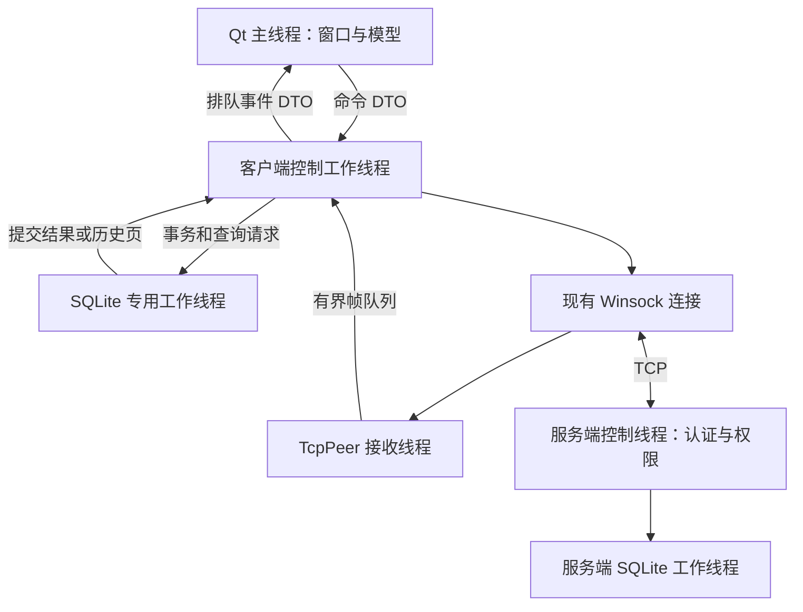

# 可视化 多线程与数据库扩展计划

2026-09-23 · 模拟即时通信系统 · 状态：待实施

本计划依据《2026-面向对象程序课程设计.doc》第八部分，在现有 C++17 即时通信工程上扩展可视化 QQ、多人聊天与聊天记录查询。建议采用 Qt 6 Widgets、现有 Winsock 网络层和 SQLite，优先完成可靠消息存储，再建立异步应用接口，最后接入图形界面。本文是实施计划，不代表扩展功能已经完成。

## 1 任务书约束与交付范围

| 原始条款 | 本计划中的落实方式 |
| --- | --- |
| 第一部分：账号、好友、群、开通、登录及动态群模式 | 复用已有领域服务及事务；扩展不改变基础业务语义 |
| 二.5.1：数字菜单并允许返回 | 保留 fanlx_app 控制台入口与既有测试 |
| 二.5.7：类独立文件、姓名缩写 | 自定义类继续使用 FanLX 后缀；新增类分别放置头文件与实现；涉及现有 ImClient/ImServer 时拆出独立文件 |
| 四.2：不提倡 MFC 和可视化开发技术 | 基础课设保持控制台交付；GUI 作为单独的课后扩展目标 |
| 八：课后作业，不考核；可视化 QQ、多人聊天、聊天记录查询 | 独立 GUI 客户端，支持实时单聊、至少三人群聊、数据库历史查询 |
| 八.1—4：网络、可视化、多线程、数据库编程 | Winsock + Qt Widgets + 明确线程所有权 + SQLite 事务与查询 |
| 报告要求：约 5 页，文字为主，可附类图 | 基础报告保持精简，扩展架构、测试与演示说明另附文档 |

任务书未指定 Qt、SQLite、线程数量或完成日期，以下技术选择和工期是工程建议。图表或 HTML 历史导出只能作为辅助展示，不能代替可交互的 QQ 聊天界面。

## 2 当前工程基线

| 模块 | 已有能力 | 本轮扩展缺口 |
| --- | --- | --- |
| UI | ConsoleAppFanLX 数字菜单、登录、单聊/群聊、历史输出 | 无图形客户端、会话列表、分页搜索 |
| 网络 | ImClientFanLX / ImServerFanLX、长连接、重连、心跳、离线投递、双 ACK、去重 | GUI 适配；慢客户端可能阻塞服务端控制线程，需消除该阻塞 |
| 线程 | TcpPeer 接收线程、客户端连接工作线程、有界事件队列、互斥锁 | 公共 send/history 仍可能持锁执行磁盘操作或全量复制，不宜直接在 UI 线程调用 |
| 数据 | 领域 state.json；独立 IM JSON 保存 outbox/inbox/游标和服务端消息 | JSON 不是关系数据库；需 SQLite 仓储、索引、分页查询及迁移 |
| 验证 | 九项 CTest，含网络和 IM 回归 | 数据库事务、异步取消、GUI 交互与三客户端验收 |

依据：CMakeLists.txt、src/network/TcpPeerFanLX.cpp、src/network/TcpListenerFanLX.cpp、src/ui/ConsoleAppFanLX.cpp，以及 docs/network-validation.md。当前服务端领域数据决定授权；客户端本地好友/群修改不会同步到服务端。首版 GUI 显示经服务端确认的联系人和群，不提供会造成跨端不一致的本地管理按钮；基础管理操作仍由控制台演示。

## 3 技术选择与架构

采用 Qt 6 Widgets 创建桌面界面，使用信号/槽跨线程投递值对象。保留 Winsock 和现有帧协议，不同时重写为 QTcpSocket。采用 SQLite C API 封装消息仓储，服务端和每个客户端各用独立数据库；领域账号、好友、群暂时继续使用现有 JSON 仓储。

GUI 通过可选 CMake 开关 FANLX_BUILD_GUI 构建 fanlx_gui；默认关闭时基础版不需要 Qt。锁定 Qt、编译器与 SQLite 版本，先验证 Qt 所支持的 MinGW 与当前 GCC 15.1 的 ABI/运行库兼容性，不直接混用预编译包。依赖以 CMake target 和配置路径注入，记录许可证、来源、SHA-256；不把本机 D 盘路径写死为构建前提。

建议新增类（各自独立文件）：MainWindowFanLX、LoginDialogFanLX、ChatControllerFanLX、ConversationModelFanLX、MessageModelFanLX、HistoryQueryFanLX、ChatRepositoryFanLX、SqliteChatRepositoryFanLX、DatabaseWorkerFanLX、ChatMigrationFanLX。窗口只负责交互；控制器编排用例；仓储接口隐藏 SQL；数据库工作线程独占连接。仓储接口与既有领域 RepositoryFanLX 分离，避免把平台快照和消息日志混为同一事务。

## 4 可视化功能计划

| 界面 | 功能和状态 |
| --- | --- |
| 登录 | 服务器地址、端口、用户名（QQ 账号）和登录密码；连接中、登录失败、登录成功；失败后允许重试 |
| 主窗口 | 左侧联系人/群/最近会话，中间消息列表，底部编辑器；显示在线状态、未读数及重连状态 |
| 单聊与群聊 | 输入中文文本、点击发送；区分等待本地保存、待发送、服务器已接收、失败；服务器 ACK 不显示为对端已读 |
| 历史查询 | 会话、发送者、关键词、时间范围；每页默认 50 条，最大 200 条；向前翻页与返回最新消息 |
| 生命周期 | 账号切换、注销、窗口关闭；明确提示未发送消息保留并可在下次登录重试 |

所有列表按服务器授权结果呈现。现有 v2 协议没有完整联系人/群列表请求，应在协议扩展时增加受认证保护的只读目录请求，并明确版本协商与旧客户端兼容；不从任意本地快照推断服务器群资格。首版不包含好友/群管理 RPC、文件和音视频聊天、多设备漫游。

历史结果更新携带 accountSessionId、queryId 和会话键：切换账号/会话后丢弃旧查询返回值。实时消息到达时只更新相关模型；用户查看旧记录时不强制跳到底部，使用“有新消息”提示。

## 5 多线程与资源管理计划

1. UI 主线程只创建和更新控件，不 connect、等待 ACK、执行 SQL 或调用可能做磁盘提交的旧 send/history 接口。命令提交使用有界队列；满时显示繁忙并保留输入文本。
2. 客户端控制工作线程独占连接状态、心跳、重连和消息状态机；TcpPeer 接收线程继续只接收/解帧。通过异步数据库结果决定何时发网络消息或 ACK。
3. 数据库线程独占 SQLite 写连接及语句。首版分页查询也串行执行；后续确有测量需要才增加独立只读连接，不能跨线程共享连接/语句。
4. 服务端控制线程串行进行授权和序号安排。数据库提交期间保留请求状态，不把未提交结果发布给客户端。慢端发送改为每连接有界待发送缓冲和非阻塞推进；保留帧偏移、超时和连接关闭规则，不在主循环等待单个客户端五秒。
5. 后台线程最外层捕获全部异常并发布失败事件，禁止异常逃逸导致 terminate。队列设容量和单次处理预算，恢复事件丢失时依据数据库分页补齐，不能把通知队列当作历史事实源。
6. 退出顺序：停止接收新 UI 命令 → 等待已接受事务完成或报告失败 → 停止重连并唤醒等待 → shutdown socket/回收接收线程 → 关闭数据库连接并 join 工作线程 → 销毁模型与窗口。不得持互斥锁 join；正常退出有时间预算，强制退出依赖已提交的 outbox 恢复。

初步验收目标：本机课程数据规模下，模拟 2 秒数据库延迟或断网时窗口仍可拖动、切换和取消；正常关闭目标 3 秒内完成；运行 30 分钟线程/句柄数量不持续增长。目标必须实测后才能写为完成。

## 6 数据库与一致性计划

### 6.1 数据模型

客户端数据库以服务器实例身份和账号隔离；服务端拥有持久化 instanceId，避免同 host/port 更换数据库后 messageId 冲突。登录密码只在内存里供连接与重连使用（账号库是领域快照里的 `users[].password`），不写入聊天数据库。消息 ID 与序号在 SQLite INTEGER 的有符号 64 位范围内分配，迁移遇到超范围值应明确拒绝，不能静默截断。

| 表 | 主要字段与约束 |
| --- | --- |
| schema_meta | schema_version、server_instance_id；客户端另存 owner_account、device_id、next_local_sequence |
| conversations | conversation_key 主键、scope、target、next_sequence（服务端） |
| messages | message_id 主键、conversation_key、conversation_sequence、sender、recipient、request_id、body、accepted_at_utc；UNIQUE(sender, request_id) 和 UNIQUE(conversation_key, conversation_sequence) |
| recipients（服务端） | message_id、account 联合主键；保存发送时收件人快照 |
| delivery_cursors（服务端） | account、conversation_key 联合主键、last_ack_sequence |
| outbox（客户端） | request_id 主键、local_sequence、scope、target、body、status、failure_reason |
| sync_cursors（客户端） | conversation_key 主键、last_received_sequence |

为会话序号、会话时间建立复合索引；使用绑定参数、外键与版本化迁移。历史采用 keyset 分页，按会话序号及稳定键排序，避免 OFFSET 在持续插入时跳页。关键词首版可用参数化 LIKE（处理 %/_ 的字面量语义）；测量后再决定是否启用 SQLite FTS5。

### 6.2 提交边界

- 客户端发送：事务写入 outbox 和本地计数，成功后才确认“已保存待发送”并发送 SEND。
- 服务端接收：一个事务保存消息、幂等键、会话序号、收件人和全局计数；COMMIT 成功后才发送 SEND_ACK。同 requestId 同内容返回旧结果，内容冲突拒绝。
- 客户端投递：一个事务插入消息并推进同步游标；COMMIT 成功后才发 ACK。重复 messageId 校验内容，不能通过 INSERT OR IGNORE 掩盖冲突。
- 收到 SEND_ACK 后事务更新/清理 outbox；消息正文依照已有发送者也收到 DELIVER 的机制形成统一历史，不把未成功发送文本标成已送达。
- 服务端 ACK 校验当前 inFlight 后事务推进游标。异步提交期间保持该连接状态，避免提前投递下一条后错误接受旧 ACK。
- 采用 WAL、foreign_keys=ON、明确 synchronous 设置及有界 busy 重试。数据库只读、空间不足或提交失败时不得发成功 ACK；用户可见错误且保留待发送消息。

协议当前不含时间字段；accepted_at_utc 和 server_instance_id 的传输需随协议版本一起设计。旧 JSON 消息没有可信服务器时间，迁移保留“原始时间未知”，不得伪造为发送时间。UI 可以另显示本地接收时间并明确标注。

### 6.3 迁移与恢复

仅迁移 IM JSON；领域 state.json 保持现有语义。应用持独占目录锁离线迁移，验证 schema、账号/服务器归属、消息唯一键、收件人、游标、设备 ID 和下一序号。在新数据库单事务导入，检查行数、消息内容、索引与 integrity_check/foreign_key_check，完成关闭及 WAL 检查点后才切换启用标记。

原 JSON 留作只读备份；迁移失败继续使用旧后端或明确退出，不进行双写。已在 SQLite 产生新消息后，不自动回退到旧 JSON，以免丢失新记录或复用 ID。异常恢复由 SQLite 日志与应用一致性检查处理，备份使用 SQLite backup API，不能运行中只复制主 .db 而忽略 WAL。

## 7 分阶段实施与验收

顺序：E01 → E02 → E03 → E04 → E05 → E06。预计 12—16 个有效工作日；按验收出口推进，不按估算日期宣称完成。

| 阶段 | 估算 | 主要改动 | 验收出口 |
| --- | --- | --- | --- |
| E01 基线与依赖 | 1 天 | 冻结九项测试；确定 Qt/编译器/SQLite 组合；GUI 可选目标；拆分相关现有类文件 | 基础版无 Qt 可构建；独立 Qt 空窗口与 SQLite 中文路径读写通过 |
| E02 数据库仓储 | 3 天 | 仓储接口、客户端/服务端表、事务、索引、迁移、分页查询 | round-trip、重复/冲突、回滚、账号隔离、迁移重跑、异常重启均通过 |
| E03 异步整合 | 3—4 天 | 客户端命令/数据库事件；服务端提交状态机与非阻塞发送；迁移现有 IM 存储 | 原 im_behavior 通过；ACK 丢失、满队列、磁盘失败与慢端不阻塞其它用户 |
| E04 图形客户端 | 3—4 天 | 登录、授权目录协议、会话模型、聊天编辑器、实时事件与重连提示 | 三个独立客户端真实收发；账号切换无旧消息泄露；界面不执行阻塞操作 |
| E05 历史与故障验收 | 1—2 天 | 搜索/分页/时间语义、数据量测量、异步取消、关闭流程 | 10 万条测试记录查询；中文/特殊字符；切换查询无过期结果；故障恢复正确 |
| E06 交付 | 1—2 天 | 部署 Qt/SQLite 运行依赖、帮助文档、UML、扩展报告与演示数据 | 无开发环境的干净目录启动；完整 CTest + GUI 手工清单 + 三客户端录像/截图 |

各阶段修改 docs/progress.md 时明确区分“计划”“实现”“实际验证”。扩展功能完成后再更新 README/HELP 的使用命令，不能提前写成已支持。

## 8 验证清单与演示流程

新增数据库测试验证持久化、约束、搜索、分页、空结果、UTF-8、中文路径、只读目录、版本不兼容、事务失败和迁移。新增多线程集成测试覆盖队列满、异常通知、重连与关闭竞争、账号切换、SQL 延迟和慢接收方。Release 下关键检查必须保持生效，不能仅依赖被 NDEBUG 消除的 assert。

数据库性能使用固定随机种子和隔离目录；分别记录冷/热缓存、数据量、索引、每页数量、查询 p50/p95、写入延迟、GUI 响应时间及硬件/工具版本。不把旧 ARC 内存基准当作 SQLite 或多线程吞吐证据。十万条记录下每页 50 条、索引分页 p95 小于 200 ms 作为本机目标，关键词扫描单独测量，不预先承诺相同指标。

答辩演示：启动一个服务器与三个独立账号/数据目录的 GUI 客户端；A 与 B 单聊并查询在线状态；A/B/C 在同一已授权 QQ 群收发中文；C 离线期间 A 发群消息，C 重连后只补可见消息；筛选会话/关键词并翻页；重启后查询记录；展示重复投递不增行、数据库提交失败不出现成功回执。最后运行基础数字菜单演示好友管理和群模式无损切换，证明扩展没有破坏课程必做内容。

完成标准是可运行图形聊天、真实多客户端、多线程无阻塞交互、SQLite 历史查询及恢复均有证据。只启动线程、生成空数据库或导出静态网页不能视为完成本扩展。
