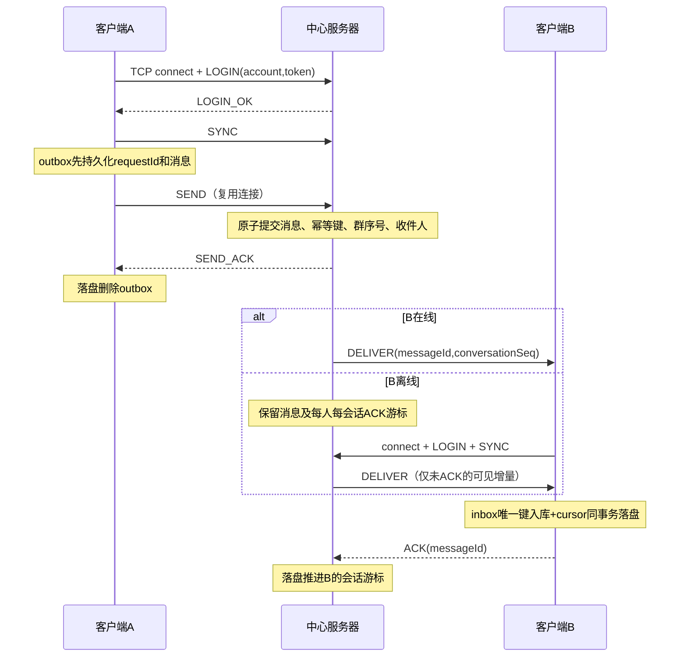

# Winsock2 中心转发 IM：增量修改与验收

2026-09-23。修改原工程中的网络、菜单、启动入口和测试文件；没有替换账户/好友/群/缓存/事务体系。实际检查发现原 TcpPeer 已能复用 TCP；本次将用户入口从双端直连改为登录后连接中心服务端。旧 v1 门面只保留兼容回归，菜单不再提供 P2P 监听/连接。

> **证据目录说明（2026-09-23 清理）**：本文提到的 `.artifacts/im-build` 等临时构建目录已删除。重新验证请自行指定构建目录（例如 `build`），或运行 `scripts/verify-release.ps1` 生成独立验证目录。

## 假设与边界

- Windows、C++17、QQ 账号与 QQ 创建的群；“类似微信”指 IM 通信模式，不新增微信平台互通。单台服务器、每账号一个活跃连接；第二个活跃会话被拒绝，旧连接关闭或心跳过期后可重连。
- 服务器的原有领域数据是好友和群授权的权威来源。客户端的领域菜单仍在本地工作，修改本地好友/群不会更改服务器授权；领域管理 RPC 不属于此次消息改造。服务端 tick 与领域变更必须处于同一控制线程，当前服务端命令行运行时不修改领域数据。
- 原工程没有密码系统，本次用服务端配置的至少 16 字符令牌验证账号。客户端令牌文件只放自己的账号。当前未实现 TLS，适用受控本机/局域网演示；不将明文令牌方案作为公网部署安全认证。
- 保证前提：双方磁盘及持久化目录保留且可写，网络最终恢复，服务端和客户端使用原存储重启。不是网络包 exactly-once：采用至少一次传输 + 幂等提交 + 持久化 inbox 唯一键，实现聊天记录只入库一次。未 ACK 的消息仍可能重传。
- 单聊目标需为好友；群发送需为群成员。群收件人取发送时的成员快照，补发时再检查当前群成员资格；新成员不补加入前消息。发送者也接收自己的持久化消息，便于统一历史与恢复。
- 现阶段日志不删除/不归档，单份存储上限 64 MiB，满后拒绝新提交并保留 outbox，不假报成功。128 连接上限、每 socket 128 接收帧队列、单会话一个未 ACK 投递窗口。串行服务器适合课程规模；慢端发送最长可阻塞控制线程 5 秒，不宣称大规模高并发能力。

## 修改点

| 原文件 | 增量变化 |
| --- | --- |
| include/network/ChatMessageFanLX.h、src/network/MessageCodecFanLX.cpp | 原长度前缀帧上增加 v2 控制消息、幂等 ID、服务端消息 ID、会话序号；保留 v1 底层回归 |
| include/network/TcpListenerFanLX.h、src/network/TcpListenerFanLX.cpp | 原 accept 之上增加 ImServerFanLX；认证会话、中心转发、在线表、权限检查、离线日志、ACK 游标；监听 backlog 改 SOMAXCONN |
| include/network/TcpPeerFanLX.h、src/network/TcpPeerFanLX.cpp | 保留 send/recv 短写/拆包实现；增加 ImClientFanLX，单工作线程拥有连接、心跳、重连、outbox/inbox |
| src/network/SocketIoFanLX.h | 复用 AtomicFileWriter 的 FlushFileBuffers + 原子发布，候选 JSON 提交成功才更新内存 |
| include/ui/ConsoleAppFanLX.h、src/ui/ConsoleAppFanLX.cpp | 配置 IM 后登录即连接，跨聊天菜单复用；单聊/群聊/历史/状态查询；注销/切换账号时断开 |
| src/main.cpp | 在同一可执行程序增加服务端模式和客户端连接配置 |
| CMakeLists.txt、tests/network_tests.cpp | 保持 ws2_32/Threads，复用持久化库；新增 im_behavior |

winsock2.h、socket、bind、listen、accept、connect、send、recv 均保留。MSVC 链接 ws2_32.lib；MinGW 链接同名系统库。

## 协议字段

4 字节无符号网络字节序长度 + UTF-8 JSON，载荷 1..16384 字节。v2 严格 11 个平坦属性；拒绝重复键、嵌套对象/数组、非法 UTF-8、负序号、控制字符与超限帧。

| 字段 | 类型/约束 | 含义 |
| --- | --- | --- |
| version | 整数 2 | IM 版本 |
| service | 字符串 QQ | 原平台隔离 |
| type | 字符串枚举 | 见消息类型表 |
| sender | 字符串，最多128字节 | LOGIN 为申请账号；后续由认证会话绑定，伪造发送者拒绝 |
| recipient | 字符串，最多128字节 | 单聊好友账号或群号；QUERY 为好友账号 |
| sequence | uint64 | 客户端本地提交序号，重连不清零；DELIVER 中为0 |
| text | UTF-8，最多4096字节 | SEND 内容；LOGIN 令牌；PRESENCE 为 online/offline；ERROR 为原因 |
| requestId | 字符串，最多128字节 | 持久化设备随机标识 + 持久化计数；发送与重试保持一致 |
| scope | direct / group | 会话类型 |
| messageId | uint64 | 服务端全局唯一递增 ID；ACK 指向此 ID |
| conversationSeq | uint64 | 服务端分配，单聊会话/群内递增；群离线增量与去重依据 |

| type | 方向与语义 |
| --- | --- |
| LOGIN / LOGIN_OK | 客户端认证 / 服务端绑定会话成功；TCP connect 成功不等于登录成功 |
| SEND / SEND_ACK | 提交消息 / 消息及幂等信息已经原子落盘；不是已读回执 |
| DELIVER / ACK | 实时或离线投递 / 接收端 inbox 已落盘；不是用户已经阅读 |
| SYNC / SYNC_END | 登录后申请补发 / 当前无可见未确认消息；增量游标来自服务端已持久化 ACK |
| QUERY / PRESENCE | 查询好友在线状态 / 查询响应及好友上下线事件；非好友统一拒绝，无在线信息 |
| PING / PONG | 5秒应用心跳 |
| ERROR | 权限、身份、请求冲突、存储等错误；客户端保留未成功确认的 outbox |

游标由服务端保存，客户端不能提交任意高 cursor 跳过消息。ACK 必须等于当前连接实际投递的 inFlight messageId，服务端从日志反查 conversationSeq 后推进该用户对应会话的游标。重复 SEND 使用 (认证账号, requestId) 查询原结果；内容或目标不同则拒绝。

## 数据结构与线程

- `ImServerFanLX::Impl::Session`：peer、认证 user、last 心跳时间、inFlight、sentAt、syncing。登录态只在内存，重启全部离线。
- `im-server/state.json`：schema、next 全局编号、seqs[conversation]、messages[]、acks[user][conversation]。每行消息携带完整帧与 recipients 发送时收件人快照；同一原子快照同时保存内容、ID、序号、幂等信息和收件人。单聊键 d|较小账号|较大账号；群键 g|群号。
- `im-client/<账号十六进制>/state.json`：schema、账号、服务器 host/port、device、next、outbox[requestId]、inbox[messageId]、cursors[conversation]。恢复时核对账号和服务器；不允许误用其它账号或服务器存储。令牌不写入消息库。
- 服务器单控制线程修改领域/消息状态；TcpPeer 后台线程只 recv/解帧。客户端工作线程唯一执行 connect/send/close，公开方法用 mutex 保护磁盘状态。短写继续发送；半帧发送失败则关闭连接，不续接下一帧。
- 每个存储目录均沿用 DataDirectoryLock 独占锁；磁盘提交失败不清 outbox、不发成功 ACK。inbox 与游标在一个快照中发布后才 ACK；通知队列溢出只影响提示，完整记录可从 history 查看。

## 关键时序



- LOGIN_OK 后向在线好友广播 online，并为新会话发送好友状态；recv=0、异常、注销或心跳过期后广播 offline。QUERY 每次查服务端好友关系，群成员身份本身不会赋予在线状态查询权限。
- 无数据仍每5秒 PING；客户端15秒无响应重连，服务端20秒无请求关闭；DELIVER 10秒未 ACK 关闭该会话，使下次登录重新同步。
- 重连采用100毫秒起、上限5秒的指数退避和0..96毫秒抖动。重新认证后 SYNC，同时按本地 sequence 重发 outbox。socket 不跨线程关闭。
- 服务端提交后 SEND_ACK 丢失：重发同 requestId，返回相同 messageId，不再产生新消息。
- 接收端入库后 ACK 丢失：重放相同 messageId，客户端跳过重复入库但仍 ACK。服务端游标已落盘则不再投递。
- 同一个群按 conversationSeq 同步；其它群各有独立游标。群成员可见区间允许序号空洞，不能用全局 messageId 的相邻性判断丢消息。

## 启动与操作

以下路径均为示例新目录；不覆盖既有数据。先初始化服务端、A、B三个不同数据目录：

```powershell
.\build\fanlx_app.exe --data-dir data-im-server --init-demo
.\build\fanlx_app.exe --data-dir data-im-a --init-demo
.\build\fanlx_app.exe --data-dir data-im-b --init-demo
```

准备 UTF-8 JSON 令牌文件（示例值请替换成随机令牌）：

```json
{"2026001":"replace-with-random-token-A","2026002":"replace-with-random-token-B"}
```

服务端 `server-tokens.json` 放全部准入账号；客户端 `a-token.json` 只放 A，`b-token.json` 只放 B。三个终端运行：

```powershell
.\build\fanlx_app.exe --data-dir data-im-server --im-server --im-host 127.0.0.1 --im-port 9500 --im-tokens server-tokens.json
.\build\fanlx_app.exe --data-dir data-im-a --im-host 127.0.0.1 --im-port 9500 --im-tokens a-token.json
.\build\fanlx_app.exe --data-dir data-im-b --im-host 127.0.0.1 --im-port 9500 --im-tokens b-token.json
```

客户端主菜单1登录QQ 2026001/2026002。登录后后台建立一条服务端 TCP；本地账号登录和服务端 LOGIN_OK 是不同状态，聊天菜单显示在线/连接中及错误。主菜单6进入聊天：1单聊、2全部历史、3群聊、4好友在线查询、5状态通知、0返回。返回菜单继续收消息，注销/退出才断开。群号1001，成员含2026001/2026002/2026003。服务端 Ctrl+C 正常停止，重启沿用同目录；客户端会自动恢复。

## 验收标准与实测

构建与测试：在任意构建目录完成即可，例如 `cmake --build build -- -j4` 后 `ctest --test-dir build --output-on-failure -j 4`；发布级证据由 `scripts/verify-release.ps1` 在独立目录生成。

| 验收 | 必须满足 | 对应自动测试 |
| --- | --- | --- |
| 长连接 | 登录后多条消息共用一条连接；切聊天目标不 connect | im_behavior 比较 connectionsAccepted |
| 单聊 | 在线实时双向转发，离线消息上线补发 | A/B真实回环TCP、离线/在线消息内容与历史数量 |
| 群聊 | 在线成员实时收；离线成员只补增量；非成员拒绝 | A/B/C群1001、conversationSeq=1/2、D拒绝 |
| 在线隐私 | 好友上线/下线广播及查询；陌生人收不到/查不到 | A/B状态事件，C查询拒绝且无好友广播 |
| 发送幂等 | SEND_ACK丢失后相同请求只保留一条记录 | raw TCP重连重发、ID一致；同ID改内容拒绝 |
| 接收幂等 | 接收落盘后ACK丢失，重放只入库一次且继续ACK | 构造崩溃时合法磁盘状态，真实客户端恢复与SYNC_END |
| 重启 | 服务端重建、客户端重建恢复outbox/inbox/cursor | 保留目录重建对象并自动重连，数量不增不减 |
| 写盘失败 | 不回成功ACK，不消耗消息ID，恢复后可重试 | 真实Win32只读主文件故障，恢复写权限后同ID重试 |
| 鉴权 | 错误令牌、伪造sender、非群成员、伪造ACK拒绝 | 真实TCP请求与ERROR断言 |
| 传输与旧功能 | 拆包/粘包/短连接退出/有界队列和领域原回归不退化 | 原network_behavior及其它7项CTest |

已通过 Debug 全量9项；新增 IM 用例包含以上正常路径及确定性故障窗口。IM 重启测试为真实 socket + 持久化目录 + 对象生命周期重建，接收崩溃窗口为磁盘状态构造，不宣称做过断电或每个指令点的强杀试验。原 network_behavior 仍含真实双进程100条中文往返。未实测跨机器、物理断电、磁盘彻底耗尽、128连接压测、真实公网半开和全部心跳超时路径。

删除客户端存储、回退服务端快照或永久丢盘超出本次“不丢不重”前提；当前没有全历史重新下载/日志清理/多设备漫游接口。生产扩展应将当前原子快照提交替换成数据库事务及唯一索引，并加 TLS，保留上层协议与确认顺序。

额外命令行实测：使用独立 server 进程和 Python 原始 v2 TCP 客户端，在 SEND_ACK 后强制终止服务端进程；重启同一可执行程序与数据目录后，相同 requestId 返回同一 messageId，离线接收者获得原消息并完成 ACK/SYNC_END。通过。证据目录：`C:/Users/25686/AppData/Local/Temp/fanlx-im-process-x7mdgpa5`。此项验证进程被终止后的恢复，不等同于物理断电。
