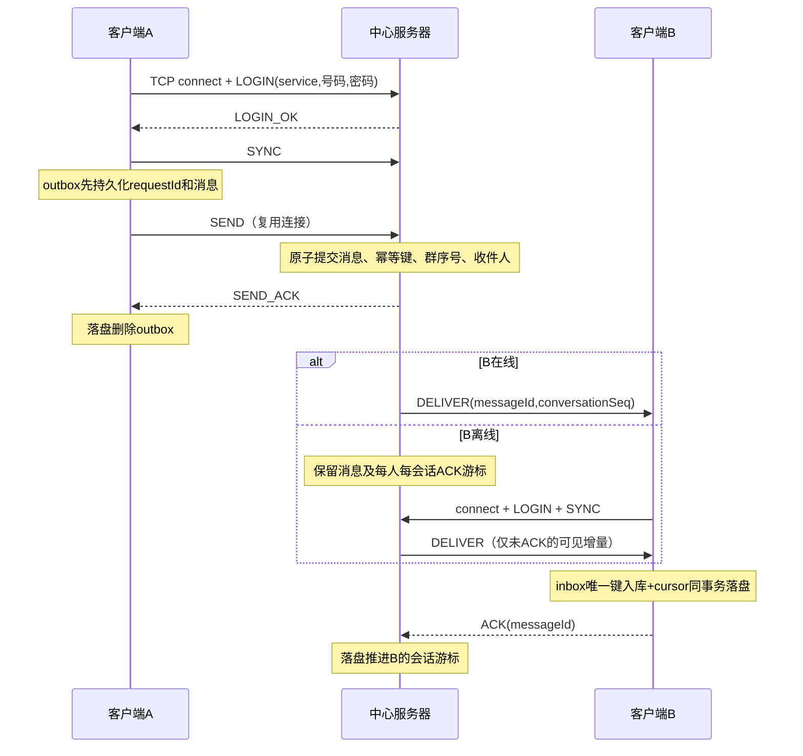

# Winsock2 中心转发 IM：增量修改与验收

2026-09-23。修改原工程中的网络、菜单、启动入口和测试文件；没有替换账户/好友/群/缓存/事务体系。实际检查发现原 TcpPeer 已能复用 TCP；本次将用户入口从双端直连改为登录后连接中心服务端。旧 v1 门面只保留兼容回归，菜单不再提供手工的 P2P 监听/连接。

> **2026-10-14 在线好友单聊可以再开一条客户端之间的 TCP。** 服务器连接仍是控制面：登录、权限、落盘、ACK 和游标都在上面。群、离线、非好友和临时会话仍是本文的 `DELIVER`。直连的协商、票据、3 秒回退和实测见 [hybrid-tcp.md](hybrid-tcp.md)。不发 `P2P_HELLO` 的客户端行为与本文一致。

> **2026-10 按服务分区改造（本文相关部分的修订）**：一条 IM 连接现在固定属于**一个聊天服务**（QQ / 微信 / 微博）。LOGIN 带上 `service`，服务端按 `(服务, 号码, 密码)` 认证，好友判定、群成员判定、在线状态、授权目录与投递全部只在该服务的分区里进行。微X 是 QQ / 微信 / 微博 的**上层登录身份**，本身没有聊天通道；**三种下级服务都能单聊，只有 QQ 与微信有群**。客户端聊天库按"服务器身份 + 登录账号 + 服务"派生（`<账号目录>/<服务名>`），因此 QQ / 微信 / 微博 天然各一份、互不可见——即使 QQ 与微博共用同一个号码也不会串。服务端内部一律用**通道标识** `<服务名>|<号码>` 存放与投递，出站帧（`DELIVER` / `SEND_ACK` / `DIRECTORY_LIST`）剥回纯号码，客户端协议不变。下文协议、数据结构、启动与验收章节均已按此更新。

> **证据目录说明（2026-09-23 清理）**：本文提到的 `.artifacts/im-build` 等临时构建目录已删除。重新验证请自行指定构建目录（例如 `build`），或运行 `scripts/verify-release.ps1` 生成独立验证目录。

## 假设与边界

- Windows、C++17、QQ 账号与 QQ 创建的群；“类似微信”指 IM 通信模式，不新增微信平台互通。单台服务器、每账号一个活跃连接；第二个活跃会话被拒绝，旧连接关闭或心跳过期后可重连。**一条连接只服务一个聊天服务**：QQ 连接看不到微信的好友与群，反之亦然；QQ / 微信 / 微博 三条通道都能单聊，**只有 QQ 与微信有群**（微博的群列表恒为空、群操作被拒）；微X（上层登录身份）没有聊天通道，不能建立 IM 连接。
- 服务器的原有领域数据是好友和群授权的权威来源。客户端的领域菜单仍在本地工作，修改本地好友/群不会更改服务器授权；领域管理 RPC 不属于此次消息改造。服务端 tick 与领域变更必须处于同一控制线程，当前服务端命令行运行时不修改领域数据。
- 原工程没有密码系统。2026-09-30 起登录改为「用户名 + 用户自选密码」：账号库就是领域快照里的账号（`state.json` → `users[].password`，课程范围内**明文**保存，暂不考虑安全性），服务端直接查同一份账号库，不再持有令牌表或预共享密钥。2026-10 起登录身份收敛为**微X号**（QQ / 微信 / 微博 是登录之后在内部开通的下级服务），而 IM 连接仍以**聊天服务的号码**（QQ 号 / 微信号 / 微博号）认证——它们共用同一个人的同一个密码。旧的令牌文件、`--im-tokens`、`--token` / `--tokens` 与 `scripts/im-tokens.ps1` 均已移除（历史机制见下文「修改点」脚注）。当前未实现 TLS，适用受控本机/局域网演示；不将明文口令方案作为公网部署安全认证。
- 保证前提：双方磁盘及持久化目录保留且可写，网络最终恢复，服务端和客户端使用原存储重启。不是网络包 exactly-once：采用至少一次传输 + 幂等提交 + 持久化 inbox 唯一键，实现聊天记录只入库一次。未 ACK 的消息仍可能重传。
- 单聊目标需为好友；群发送需为群成员。群收件人取发送时的成员快照，补发时再检查当前群成员资格；新成员不补加入前消息。发送者也接收自己的持久化消息，便于统一历史与恢复。
- 现阶段日志不删除/不归档，单份存储上限 64 MiB，满后拒绝新提交并保留 outbox，不假报成功。128 连接上限、每 socket 128 接收帧队列、单会话一个未 ACK 投递窗口。串行服务器适合课程规模；慢端发送最长可阻塞控制线程 5 秒，不宣称大规模高并发能力。

## 修改点

| 原文件 | 增量变化 |
| --- | --- |
| include/network/ChatMessageFanLX.h、src/network/MessageCodecFanLX.cpp | 原长度前缀帧上增加 v2 控制消息、幂等 ID、服务端消息 ID、会话序号；保留 v1 底层回归 |
| include/network/TcpListenerFanLX.h、src/network/TcpListenerFanLX.cpp | 原 accept 之上增加 ImServerFanLX；认证会话、中心转发、在线表、权限检查、离线日志、ACK 游标；监听 backlog 改 SOMAXCONN |
| include/network/TcpPeerFanLX.h、src/network/TcpPeerFanLX.cpp | 保留 send/recv 短写/拆包实现；增加 ImClientFanLX，单工作线程拥有连接、心跳、重连、outbox/inbox |
| src/network/SocketIoFanLX.h | 复用 AtomicFileWriter 的 FlushFileBuffers + 原子发布，候选 JSON 提交成功才更新内存 |
| include/ui/ConsoleAppFanLX.h、src/ui/ConsoleAppFanLX.cpp | 配置 IM 后登录即连接，跨聊天菜单复用；单聊/群聊/历史/状态查询；注销/切换账号时断开 |
| include/network/ClientDataPathFanLX.h（2026-09-29 新增） | 客户端存储目录统一派生为 `<根>/im-client/<host>_<端口>/<账号>`；控制台与 GUI 共用同一条规则，旧的两套目录约定（GUI 手工 `--dir`、控制台十六进制转义）合并为一 |
| include/network/ClientDataPathFanLX.h（2026-10 第二轮） | 新增 `chatDirectoryFanLX(root, host, port, service, accountId)` = `<账号目录>/<服务名>`（QQ / Wechat / Weibo）：一个服务一份聊天库与一把目录锁，QQ 与微博共用号码时也不会互相覆盖；领域库仍在 `<账号目录>/domain` |
| include/network/ChatMessageFanLX.h、src/network/MessageCodecFanLX.cpp（2026-10） | 帧新增 `service` 字段（`ChatMessageFanLX::service`，默认 `"QQ"`）；编解码只接受 QQ / Wechat / Weibo 三种下级服务，微X（上层登录身份，不承载聊天）在这一层就被拒绝 |
| include/network/ImServerFanLX.h、src/network/ImServerFanLX.cpp（2026-10） | 会话带 `service`；LOGIN 按 `(服务, 号码, 密码)` 认证（接受 QQ / Wechat / Weibo）；好友判定、群成员判定、在线状态、`DIRECTORY_LIST` 与投递全部只在该服务的分区里进行；出站帧统一由 `write()` 打上会话服务名；`presence` 只在本服务的会话之间广播 |
| src/network/ImServerFanLX.cpp（2026-10 第二轮） | 服务端内部改用**通道标识**：新增 `channelIdFanLX` / `plainIdFanLX` / `channelKeyFanLX` / `parseChannelKeyFanLX`，SQLite 的 `sender`/`target`/`recipients`/`delivery_cursors.account`/`conversations.conversation_key` 与旧 JSON 的会话键、`acks` 键全部带 `<服务名>|` 前缀；出站帧剥回纯号码。微博会话 `member()` 恒为假、`groupRecipients()` 恒为空、群操作报 `<服务名>没有群功能` |
| src/db/ChatMigrationFanLX.cpp（2026-10 第二轮） | `--im-migrate` 迁移旧 JSON 服务端日志时，账号 / 群号 / 会话键 / 投递游标一律补 `QQ|` 前缀（旧服务端只服务 QQ 一条通道），迁移后的键与新版实时写入的键一致 |
| include/network/ImClientFanLX.h、src/network/ImClientFanLX.cpp（2026-10） | 新增 `service` 构造参数（默认 `"QQ"`，非 QQ / Wechat / Weibo 直接拒绝）与 `serviceName()`、`authenticationRejected()`、`authenticationRejectionReason()`：服务器在认证前返回 ERROR 时记为"登录被拒"，供界面判断 |
| include/ui/ConsoleAppFanLX.h、src/ui/ConsoleAppFanLX.cpp（2026-10） | 主菜单 1 改为「登录微X或注册」；聊天连接的 `ImClientFanLX` 按 `(服务, 号码)` 建连（QQ / 微信 / 微博），聊天菜单按服务给选项：微博不显示「3 群聊发送」并标注"（本服务没有群）"；微X没有聊天通道 |
| src/main.cpp | 在同一可执行程序增加服务端模式和客户端连接配置 |
| CMakeLists.txt、tests/network_tests.cpp | 保持 ws2_32/Threads，复用持久化库；新增 im_behavior |

winsock2.h、socket、bind、listen、accept、connect、send、recv 均保留。MSVC 链接 ws2_32.lib；MinGW 链接同名系统库。

> **2026-09-30 凭据改造（上表 2026-09-23 增量的后续修订）**：原「服务端令牌表 + 客户端令牌文件」的认证方式已整体删除，改为「用户名 + 密码」，账号库就是领域快照本身。落点：`AccountManagerFanLX::login(service, accountId, password, confirmOthers)`（账号不存在与密码错误统一抛 `CredentialRejectedFanLX("用户名或密码错误")`，让调用方无法据此枚举账号）；`ImServerFanLX` 的 LOGIN 直接 `state.accounts.verifyPassword(QQ, sender, text)`，构造函数不再接收凭据表；LOGIN_OK 后的好友在线快照也不再遍历令牌表（令牌表本身就是准入名单，规模可控），改为从**本人的好友关系**出发：`state.friends.peers` → `IdentityResolverFanLX` 换算到对端 QQ 账号，再逐个 `friends()` 复核，代价只随好友数增长而不是库里账号总数；`ImClientFanLX` 构造函数第 4 个参数由 token 改为 password，**wire 协议不变**（LOGIN 帧 `sender` = 用户名，`text` = 密码）；`src/main.cpp` 删除 `--im-tokens`，`src/gui/main_gui.cpp` 删除 `--token` / `--tokens` 改为 `--account` + `--password`。理由：密码本来就该由用户自选，而账号库已经随快照持久化；再单独维护一份凭据文件等于把同一事实存两遍，新增账号还得手工分发并重启。改造后新增账号重启服务端即生效，凭据分发步骤与 `scripts/im-tokens.ps1` 一起消失。

> **2026-10 按服务分区改造（对上一条的后续修订）**：上段里的 `verifyPassword(QQ, sender, text)` 与
> `state.friends.peers` 已改为 `verifyPassword(service, sender, text)` 与
> `state.friends.directory(service).peers(...)`；LOGIN 帧新增 `service` 字段，"wire 协议不变"这一句
> 仅对 2026-09-30 那次改造成立。此外注册入口从"登录后的账号菜单"移到**登录入口**，注册只建微X身份、
> 不捆绑任何下级服务；`src/gui/main_gui.cpp` 的 `--account` / `--password` 现在填的是**微X号**，
> 聊天连接另按"当前服务"取 QQ 号 / 微信号 / 微博号。详见本文开头的 2026-10 说明与「协议字段」的「服务维度」小节。
>
> **2026-10 第二轮（上一条的后续修订）**：`service` 的三个取值是 QQ / Wechat / Weibo，
> "微博没有聊天通道"不再成立——微博能单聊，只是没有群；服务端内部改用通道标识 `<服务名>|<号码>`
> 存放与投递，出站帧剥回纯号码，因此客户端协议与客户端库格式不变。客户端聊天目录由
> `<账号目录>` 改为 `<账号目录>/<服务名>`，三条通道各一份聊天库。

## 协议字段

4 字节无符号网络字节序长度 + UTF-8 JSON，载荷 1..16384 字节。v2 严格 11 个平坦属性；拒绝重复键、嵌套对象/数组、非法 UTF-8、负序号、控制字符与超限帧。

| 字段 | 类型/约束 | 含义 |
| --- | --- | --- |
| version | 整数 2 | IM 版本 |
| service | 字符串 QQ / Wechat / Weibo | 本连接所属的**聊天服务**；编解码只接受这三个取值（微X 是上层登录身份，被拒绝）。服务端出站帧统一按会话服务填写 |
| type | 字符串枚举 | 见消息类型表 |
| sender | 字符串，最多128字节 | LOGIN 为申请登录的**该服务号码**（QQ 号 / 微信号 / 微博号，不是微X号）；后续由认证会话绑定，伪造发送者拒绝。出站帧里始终是纯号码（服务端的通道前缀不出现） |
| recipient | 字符串，最多128字节 | 单聊好友账号或群号；QUERY 为好友账号。好友与群都在本服务的分区内判定 |
| sequence | uint64 | 客户端本地提交序号，重连不清零；DELIVER 中为0 |
| text | UTF-8，最多4096字节 | SEND 内容；LOGIN 为登录密码（明文，仅本次连接使用）；PRESENCE 为 online/offline；ERROR 为原因（认证失败固定为 `用户名或密码错误`，密码正确但该服务未开通为 `该账号未开通 <服务中文名> 服务`） |
| requestId | 字符串，最多128字节 | 持久化设备随机标识 + 持久化计数；发送与重试保持一致 |
| scope | direct / group | 会话类型 |
| messageId | uint64 | 服务端全局唯一递增 ID；ACK 指向此 ID |
| conversationSeq | uint64 | 服务端分配，单聊会话/群内递增；群离线增量与去重依据 |

**服务维度（2026-10 新增，第二轮修订）**

`service` 不是一个可以事后忽略的展示字段，它决定这次连接的全部权限范围：

- **LOGIN**：`service` 决定认证落在哪个服务（`verifyPassword(service, sender, text)`），
  也决定会话的服务。服务端接受 `QQ` / `Wechat` / `Weibo` 三个取值；
  其余取值（含微X）直接回错误：`聊天通道只支持 QQ / 微信 / 微博（微X 是上层登录身份）`。
- **认证之后**：`SEND` / `SYNC` / `ACK` / `QUERY` 的收件人一律在该服务的分区里查——
  好友关系取自 `friends.directory(service)`，群成员取自 `modeOfFanLX(service)` 对应的群命名空间
  （QQ → `GroupModeFanLX::QQ`，微信 → `GroupModeFanLX::Wechat`；微博没有群命名空间，一律失败），
  在线表按 `(服务, 号码)` 匹配。因此"用 QQ 的好友关系给微信号发单聊"在服务端不成立。
- **内部键带通道前缀，出站帧是纯号码**：服务端把账号、群号、会话键与投递游标一律写成
  `<服务名>|<号码>`（群聊会话键 `g|QQ|1001`、单聊 `d|QQ|2026001|QQ|2026002`），
  但 `DELIVER` 的 `sender` / `recipient`、`SEND_ACK`、`DIRECTORY_LIST` 里的好友与群号都剥回纯号码。
  QQ 与微博按课程约定共用同一个号码，两条通道因此互不串消息，而客户端看到的仍是 `2026001`、群号 `1001`。
- **DIRECTORY_LIST**：载荷为
  `{"schema":"fanlx-directory-1","service":"QQ"|"Wechat"|"Weibo","friends":[...],"groups":[...]}`，
  好友只列本服务分区，群只列本服务命名空间——微博的 `groups` 恒为空数组。
- **群只属于 QQ 与微信**：微博会话里 `member()` 恒为假、`groupRecipients()` 恒为空，
  发送群消息直接回 `<服务名>没有群功能`（例如 `微博没有群功能`）。
- **PRESENCE**：登录成功后的 online 广播、好友在线快照与上下线事件都**只在本服务的会话之间**发生，
  QQ 的上线不会推给微信或微博连接。
- **微X 是上层登录身份，不在这条通道里**：微X 用来登录领域库、开通下级服务，
  它自己没有聊天通道（`MessageCodecFanLX` 与 `ImClientFanLX` 均在入口拒绝 `WeiX`）。

| type | 方向与语义 |
| --- | --- |
| LOGIN / LOGIN_OK | 客户端认证 / 服务端绑定会话成功；TCP connect 成功不等于登录成功 |
| SEND / SEND_ACK | 提交消息 / 消息及幂等信息已经原子落盘；不是已读回执 |
| DELIVER / ACK | 实时或离线投递 / 接收端 inbox 已落盘；不是用户已经阅读 |
| SYNC / SYNC_END | 登录后申请补发 / 当前无可见未确认消息；增量游标来自服务端已持久化 ACK |
| QUERY / PRESENCE | 查询好友在线状态 / 查询响应及好友上下线事件；非好友统一拒绝，无在线信息 |
| PING / PONG | 5秒应用心跳 |
| ERROR | 权限、身份、请求冲突、存储等错误；客户端保留未成功确认的 outbox |

游标由服务端保存，客户端不能提交任意高 cursor 跳过消息。ACK 必须等于当前连接实际投递的 inFlight messageId，服务端从日志反查 conversationSeq 后推进该用户对应会话的游标。重复 SEND 使用 (认证账号, requestId) 查询原结果；内容或目标不同则拒绝。

**发送前预检与"毒消息"防护（2026-09-29 新增）**

正文的长度 / 控制字符 / UTF-8 校验必须在**写入 outbox 之前**完成
（`MessageCodecFanLX::textIssueFanLX`，与 `encode()` 的规则同处定义，避免两套标准不一致）。
若只在组帧时校验，一条永远无法组帧的消息会先被持久化为"待发送"，之后每次重连都被
`replayOutboxFanLX` 重放并抛异常；异常被工作线程的 catch 吞掉后只触发重连，于是形成
"永远重连、永远不到线"的死循环——这就是毒消息。配套三点：

1. `submitSend` / `submitSendToConversation` 在写库前预检，不合法直接抛可读原因（不入库）；
2. `pending()` 只取 `state='pending'`。`failed` 是终态，不再被重放（失败原因随消息留存，仍可在消息列表看到）；
3. 重放与命令循环对**单条**消息单独 catch：标记失败后跳过，不让一条消息把整条连接带崩。

可触发毒消息的输入：正文 > 4096 字节（约 1365 个汉字）、含控制字符（`\n`/`\t` 除外）、
非法 UTF-8（例如从 GBK 控制台粘贴）、服务器明确拒绝的消息。
GUI 侧编辑器按 UTF-8 字节数实时裁剪并显示"已用字节"，避免输入注定发不出去的内容。

## 数据结构与线程

- `ImServerFanLX::Impl::Session`：peer、认证 user、**所属 service**、last 心跳时间、inFlight、sentAt、syncing。登录态只在内存，重启全部离线；在线表按 `(service, user)` 匹配，同名号码在不同服务里互不相干。
- `im-server/state.json`：schema、next 全局编号、seqs[conversation]、messages[]、acks[user][conversation]。每行消息携带完整帧与 recipients 发送时收件人快照；同一原子快照同时保存内容、ID、序号、幂等信息和收件人。**2026-10 第二轮起这些键都带通道前缀**（`channelIdFanLX` / `channelKeyFanLX`）：单聊键 `QQ|d|较小号码|较大号码`、群键 `QQ|g|群号`，`acks` 与 recipients 也用 `QQ|号码`；`--im-migrate` 迁移旧日志时统一补 `QQ|`（旧服务端只有 QQ 一条通道），因此迁移后的键与新版实时写入的键一致。
- `<数据根>/im-client/<host>_<端口>/<账号>/<服务名>/state.json`（SQLite 后端为同目录 `chat.db` + `client-identity.json`）：
  schema、账号、服务器 host/port、device、next、outbox[requestId]、inbox[messageId]、cursors[conversation]。
  恢复时核对账号和服务器；不允许误用其它账号或服务器存储。登录密码只在进程内存里供重连使用，不写入消息库，也不写入客户端快照。
  **客户端存储目录由服务器身份 + 登录账号 + 服务派生，不接受用户直接指定**（规则见
  `include/network/ClientDataPathFanLX.h`，理由见 [architecture.md](architecture.md) 的「数据目录与身份边界」）。
  2026-10 起这里的"登录账号"是**该聊天服务的号码**：QQ 连接用 QQ 号、微信连接用微信号、微博连接用微博号。
  **第二轮起聊天目录还要再带一层服务名**（`chatDirectoryFanLX`）：QQ 与微博按课程约定共用同一个号码，
  两者因此派生出 `<账号目录>/QQ` 与 `<账号目录>/Weibo` 两个不同子目录，各有自己的 `chat.db`、
  `client-identity.json` 与目录锁，聊天记录天然分开、不会互相看到。
  领域库在同一账号目录下的 `domain/` 子目录（GUI 一侧由 `domainDirectoryFanLX` 派生为
  `<账号目录>/domain/state.json`；控制台的领域快照仍在它自己的数据根下），与聊天库互不覆盖、可以同时打开。
  磁盘实测（本轮手工联调用的 `data-im-a` / `data-im-b`）：同一个账号目录下同时存在
  `127.0.0.1_19530/2026001/QQ/{chat.db,client-identity.json,.lock}` 与
  `127.0.0.1_19530/2026001/Weibo/{chat.db,client-identity.json,.lock}`——同号码的两条通道各有自己的库与目录锁。
  迁移提示：旧布局把 `chat.db` / `state.json` 直接放在账号目录下；旧的客户端存储目录可以直接删除
  （历史会重新累积），`domain/` 里的领域数据不受影响。
- 服务器单控制线程修改领域/消息状态；TcpPeer 后台线程只 recv/解帧。客户端工作线程唯一执行 connect/send/close，公开方法用 mutex 保护磁盘状态。短写继续发送；半帧发送失败则关闭连接，不续接下一帧。
- 每个存储目录均沿用 DataDirectoryLock 独占锁；磁盘提交失败不清 outbox、不发成功 ACK。inbox 与游标在一个快照中发布后才 ACK；通知队列溢出只影响提示，完整记录可从 history 查看。

## 关键时序



- LOGIN_OK 后向**本服务的**在线好友广播 online，并为新会话发送好友状态；recv=0、异常、注销或心跳过期后广播 offline（同样只在本服务内）。QUERY 每次查服务端好友关系，且只查本服务分区；群成员身份本身不会赋予在线状态查询权限。
- 无数据仍每5秒 PING；客户端15秒无响应重连，服务端20秒无请求关闭；DELIVER 10秒未 ACK 关闭该会话，使下次登录重新同步。
- 重连采用100毫秒起、上限5秒的指数退避和0..96毫秒抖动。重新认证后 SYNC，同时按本地 sequence 重发 outbox。socket 不跨线程关闭。
- 服务端提交后 SEND_ACK 丢失：重发同 requestId，返回相同 messageId，不再产生新消息。
- 接收端入库后 ACK 丢失：重放相同 messageId，客户端跳过重复入库但仍 ACK。服务端游标已落盘则不再投递。
- 同一个群按 conversationSeq 同步；其它群各有独立游标。群成员可见区间允许序号空洞，不能用全局 messageId 的相邻性判断丢消息。
- **单聊同样允许序号空洞（2026-09-29 修订）**：单聊序号是两端共用的一条单调计数器，而客户端的
  `sync_cursors.last_sequence` 会被自己发出的消息（`markAccepted`）推到**该消息自身的序号**。
  因此“自己这边已到 15、对端更早的 8 还没投到”是正常局面。旧实现在这里用
  “序号必须大于已落库序号”拒绝投递，会永久拒收那条 8，且不落库、不回 ACK，服务端又反复重投，
  最终每 10 秒关会话重连——表现为**对端发不进来、自己却发得出去**的单向故障。
  现在只拒绝真正的冲突：同一会话序号被另一条消息占用（重复投递仍靠 messageId 去重拦下）。
  `last_sequence` 退化为“见过的最大序号”，仅供展示、排序与已读游标夹取，**不得**用作投递准入条件。

## 启动与操作

以下路径均为示例新目录；不覆盖既有数据。先初始化服务端、A、B三个不同数据目录：

```powershell
.\build\fanlx_app.exe --data-dir data-im-server --init-demo
.\build\fanlx_app.exe --data-dir data-im-a --init-demo
.\build\fanlx_app.exe --data-dir data-im-b --init-demo
```

准备凭据：不需要任何凭据文件。账号库就是各数据目录 `state.json` 里的 `users[]`——服务端认证时查**自己**数据目录的那份；控制台与 GUI 的本地登录查各自账号目录下的那份（`<数据根>/im-client/<服务器>_<端口>/<微X号>/domain/state.json`）。演示时三份快照都由同一个 `--init-demo` 生成，内容一致。

**登录用微X号**：演示数据里微X号就是 `2026001` 这类号码（QQ 号与微博号与它相同，微信号是 `wx_2026001`），密码由 `demoPasswordFanLX` 生成，**2026-10-10 起统一为 `123`**（历史规则为 `pw-<微X号>`，即 `2026001` → `pw-2026001`）。一个用户只有一个密码（密码存在"人"上），微X 与它下面开通的 QQ / 微信 / 微博 共用这一份，因此 IM 连接的 LOGIN 虽然填的是 QQ 号 / 微信号 / 微博号，密码仍是同一个（演示数据里就是 `123`）。

用户自己注册时在**登录入口**注册微X账号（GUI 登录窗的「注册微X账号…」按钮；控制台主菜单 1 → 2 注册微X账号），自选密码并二次确认。注册只创建微X身份，**不捆绑**任何服务账号——QQ / 微信 / 微博 要登录之后在「开通管理 / 开通下级服务」里逐个开通（可填号码，回车用建议值：QQ / 微博 = 微X号，微信 = `wx_<微X号>`）。号码只要求**在该服务内唯一**：QQ 与微博按课程约定必须共号，微信也可以直接用与 QQ 相同的号码（`activateService` 本轮取消了"QQ 号与微信号不能相同"的限制）。

> 若某个 `data-*/` 目录是两代改造之前初始化的——`users[]` 里没有 `password`（凭据改造之前），或者快照是 `schemaVersion = 1`（好友与群还是扁平数组）——服务端会直接拒绝加载。两代旧库的迁移**不必手工删目录**：`scripts\run-im-server.bat` 在启动前读 `<数据目录>/state.json` 判断格式，命中上述任一情形就把旧目录**改名保留**为 `<数据目录>.legacy-<yyyyMMdd-HHmmss>`（不删证据），自动执行 `--init-demo` 重建后再启动（空目录没有可保留的内容，直接初始化）；`-DryRun`（或 `FANLX_DRY_RUN=1`）只打印「需要重建数据目录：<原因>」与「本应改名并初始化」，不改动任何目录。也可以照上面的初始化命令手工重建（程序不做就地补字段）。

三个终端运行（服务端与两个客户端，各用不同数据目录）：

```powershell
.\build\fanlx_app.exe --data-dir data-im-server --im-server --im-sqlite --im-host 127.0.0.1 --im-port 9500
.\build\fanlx_app.exe --data-dir data-im-a --im-host 127.0.0.1 --im-port 9500 --im-sqlite
.\build\fanlx_app.exe --data-dir data-im-b --im-host 127.0.0.1 --im-port 9500 --im-sqlite
```

客户端主菜单 1（登录微X或注册）→ 1 用微X号登录：微X号 `2026001` / `2026002` 的密码都是 `123`，密码明文回显（课程范围内的取舍）；随后回答「确认联动本人已开通的下级服务？1 全部确认 0 仅当前」——选 1 就把本人已开通的下级服务一并登录（微X 是授权来源，不再要求同号或互相绑定；老规则仍作为下级服务之间的兜底），选 0 则只登录微X。登录微X并确认联动后，控制台会把"当前服务"自动切到已登录的 QQ（优先）或微信，方便直接进聊天菜单（自动切换的候选只有这两个，微博要用「账号与服务 → 切换当前服务」手动切过去）；需要开通或改服务时用「账号与服务 → 开通下级服务 / 切换当前服务」。聊天连接的 `ImClientFanLX` 按 `(服务, 号码)` 建连——QQ 用 QQ 号、微信用微信号、**微博用微博号**，三条通道都能单聊；**微X 没有聊天通道**（它是上层登录身份），当前服务停在微X 时群/好友/聊天菜单只给出"请先切到已开通的 QQ / 微信 / 微博"的提示。登录后主菜单6进入聊天：1单聊、2全部历史、3群聊、4好友在线查询、5状态通知、0返回；当前服务是**微博**时菜单不显示 3，而是写成"（本服务没有群）"，误选时输出"本服务（微博）没有群功能：只有 QQ 与微信有群"。本地微X登录和服务端 LOGIN_OK 是不同状态，聊天菜单显示在线/连接中及错误——服务端认证失败时 ERROR 帧文本就是 `用户名或密码错误`（账号不存在与密码错误刻意用同一句话，避免据此枚举账号；只有密码正确却没开通该服务才回 `该账号未开通 <服务中文名> 服务`，例如 `该账号未开通 微信 服务`）。若启动时没给 `--im-host` / `--im-port`，进入菜单 6 会直接提示 `请使用 --im-host / --im-port 配置服务端后登录微X（或切换当前服务）`，不会静默连不上。返回菜单继续收消息，注销/退出才断开。QQ 群号 1001（微信命名空间下另有同号群 1001，两者是不同服务端键空间的群），成员含2026001/2026002/2026003。服务端 Ctrl+C 正常停止，重启沿用同目录；客户端会自动恢复（重连时用本次会话留存的同一份密码）。账号菜单另有 `10 修改密码`（旧密码必须正确，新密码二次确认）。注意改密改的是**本客户端数据目录**里的账号库，服务端那份不会跟着变——领域管理不通过 IM 协议同步（注册同理），所以现有长连接仍以服务端认识的旧密码维持、不会被打断；等服务端那份也改成同一新密码后，用主菜单 1 重新登录即可（那时才用新密码建连）。若只改了客户端而没改服务端，重新登录时状态行会报 `用户名或密码错误`，见 HELP.md 6.10。

**微博单聊的复现步骤（2026-10 第二轮实测）**：两个终端各跑一个控制台客户端（数据根分别用 `data-im-a` / `data-im-b`，端口 `19530`），A 用微X号 `2026001` + 密码 `123` 登录 → 「账号与服务 → 切换当前服务」选微博 `2026001` → 主菜单 6 进聊天（菜单显示"（本服务没有群）"）→ 选 1 单聊发送，好友号码填 `2026002`、内容填 `hello-weibo`；状态行显示 `在线 待确认=0`，选 2 历史记录会看到 `单聊 2026002 #1 2026001: hello-weibo`。B 用微X号 `2026002` 登录并同样切到微博后，历史记录里出现同一条消息——服务端已接收并投递。演示数据里微博分区本来就有一条 U1↔U2 好友关系，所以这一步不需要先加好友。

GUI 一侧的登录顺序不同（2026-10）：先做**领域登录**（微X号 + 密码，身份被拒就直接返回失败、登录窗留在原地），再按"当前服务"建聊天连接并 `waitForLogin(6000ms)` 等一次服务器认证结果——连上但认证失败同样回退，不会打开主窗口。手工实测（上一轮记录，登录顺序与失败回退行为本轮未改）：`fanlx_gui --auto-login --password wrong-pw` 直接以非零码退出并打印 `自动登录失败：微X登录失败：用户名或密码错误`，没有打开主窗口；正确密码则打开主窗口。客户端目录布局本轮改为「领域库 + 每个服务一个聊天目录」：`<微X号>/domain/state.json` 是领域库，聊天库在 `<微X号>/<服务名>/chat.db`——QQ 与微博共用同一个号码时分别是 `<微X号>/QQ/` 与 `<微X号>/Weibo/`，两条通道各有自己的库与目录锁（`gui_behavior` t67/t68 断言两个客户端的 `dataDirectory()` 不同、微博目录名含 `Weibo`）。

## 验收标准与实测

构建与测试：在任意构建目录完成即可，例如 `cmake --build build -- -j4` 后 `ctest --test-dir build --output-on-failure -j 4`；发布级证据由 `scripts/verify-release.ps1` 在独立目录生成。

| 验收 | 必须满足 | 对应自动测试 |
| --- | --- | --- |
| 长连接 | 登录后多条消息共用一条连接；切聊天目标不 connect | im_behavior 比较 connectionsAccepted |
| 单聊 | 在线实时双向转发，离线消息上线补发 | A/B真实回环TCP、离线/在线消息内容与历史数量 |
| 群聊 | 在线成员实时收；离线成员只补增量；非成员拒绝 | A/B/C群1001、conversationSeq=1/2、D拒绝 |
| 在线隐私 | 好友上线/下线广播及查询；陌生人收不到/查不到 | A/B状态事件，C查询拒绝且无好友广播 |
| 发送幂等 | SEND_ACK丢失后相同请求只保留一条记录 | raw TCP重连重发、ID一致；同ID改内容拒绝 |
| 接收幂等 | 接收落盘后ACK丢失，重放只入库一次且继续ACK | 构造崩溃时合法磁盘状态，真实客户端恢复与SYNC_END |
| 重启 | 服务端重建、客户端重建恢复outbox/inbox/cursor | 保留目录重建对象并自动重连，数量不增不减 |
| 写盘失败 | 不回成功ACK，不消耗消息ID，恢复后可重试 | 真实Win32只读主文件故障，恢复写权限后同ID重试 |
| 鉴权 | 错误密码、伪造sender、非群成员、伪造ACK拒绝 | 真实TCP请求与ERROR断言；LOGIN 按 `(服务, 号码, 密码)` 认证，接受 `QQ` / `Wechat` / `Weibo` 三个 `service`；密码错/账号不存在统一回 `用户名或密码错误`，密码对但该服务未开通回 `该账号未开通 <服务中文名> 服务`；微X 及其它未知 `service` 在编解码与 LOGIN 两处被拒 |
| 服务隔离（2026-10） | 一条连接只服务一个聊天服务：QQ 连接只看到 QQ 好友与 QQ 群、微信连接初始好友为空、QQ 好友关系不能用于微信单聊、两个客户端聊天库目录不同 | gui_behavior t67（真实服务端 + 两个 `ChatControllerFanLX`）；t66 覆盖按服务认证被拒（含账号不存在）与微X在 start 阶段被拒 |
| 微博单聊（2026-10 第二轮） | 微博除群以外全部可用：能登录上线、`DIRECTORY_LIST` 里有好友且 `groups` 为空数组、能给好友发单聊并被服务端接收、历史里能查到 | gui_behavior t68（真实服务端 + 微博通道的 `ChatControllerFanLX`，断言好友数、空群列表与"服务端已接收"）；手工双终端实测见上文「微博单聊的复现步骤」 |
| 同号码双通道隔离（2026-10 第二轮） | QQ 与微博共用同一个号码时两条通道的消息互不串：同号码的 QQ 客户端看不到微博消息，两者的聊天目录不同 | gui_behavior t68（断言 `dataDirectory()` 不同、微博目录名含 `Weibo`，且 QQ 侧历史里没有那条微博消息）；chat_history_behavior t53（服务端迁移后的账号 / 会话键 / 游标都带 `QQ|` 前缀） |
| 传输与旧功能 | 拆包/粘包/短连接退出/有界队列和领域原回归不退化 | 原network_behavior及其余默认CTest（`-E performance` 共13项） |

已通过 Debug 全量 13 项（`ctest --test-dir build -E performance`：13/13 passed，约 32 秒，含 `im_behavior`、`persistence_behavior`、`console_behavior`、`gui_behavior`、`gui_domain_behavior`、`gui_three_client_behavior`；注册的 14 项里 `chat_history_performance` 是性能项，默认不跑）；新增 IM 用例包含以上正常路径及确定性故障窗口。IM 重启测试为真实 socket + 持久化目录 + 对象生命周期重建，接收崩溃窗口为磁盘状态构造，不宣称做过断电或每个指令点的强杀试验。原 network_behavior 仍含真实双进程100条中文往返。未实测跨机器、物理断电、磁盘彻底耗尽、128连接压测、真实公网半开和全部心跳超时路径。

**数据目录重建实测（2026-10 第二轮）**：对一份 `schemaVersion = 1` 的 `data-im-server` 直接运行 `scripts\run-im-server.bat`，脚本自动把它改名为 `data-im-server.legacy-20260929-233359`（保留证据）、执行 `--init-demo` 重建后正常监听（`Test-NetConnection` 返回 True）；`data-im-a` / `data-im-b` 也按同样方式重建为 `schemaVersion = 2`。干跑模式（`-DryRun` / `FANLX_DRY_RUN=1`）只打印重建原因与计划，不改动任何目录。

删除客户端存储、回退服务端快照或永久丢盘超出本次“不丢不重”前提；当前没有全历史重新下载/日志清理/多设备漫游接口。生产扩展应将当前原子快照提交替换成数据库事务及唯一索引，并加 TLS，保留上层协议与确认顺序。

额外命令行实测：使用独立 server 进程和 Python 原始 v2 TCP 客户端，在 SEND_ACK 后强制终止服务端进程；重启同一可执行程序与数据目录后，相同 requestId 返回同一 messageId，离线接收者获得原消息并完成 ACK/SYNC_END。通过。证据目录：`C:/Users/25686/AppData/Local/Temp/fanlx-im-process-x7mdgpa5`。此项验证进程被终止后的恢复，不等同于物理断电。
